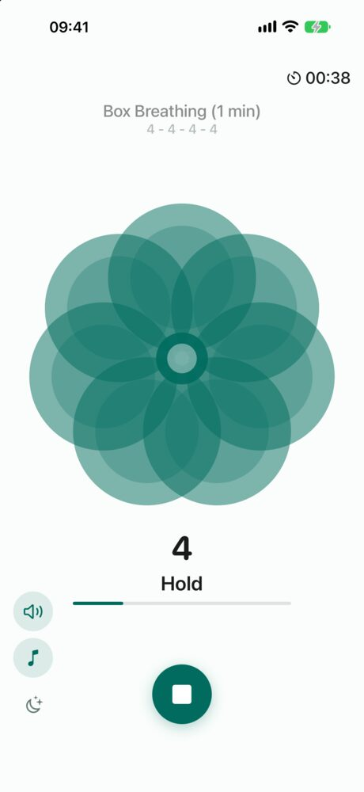
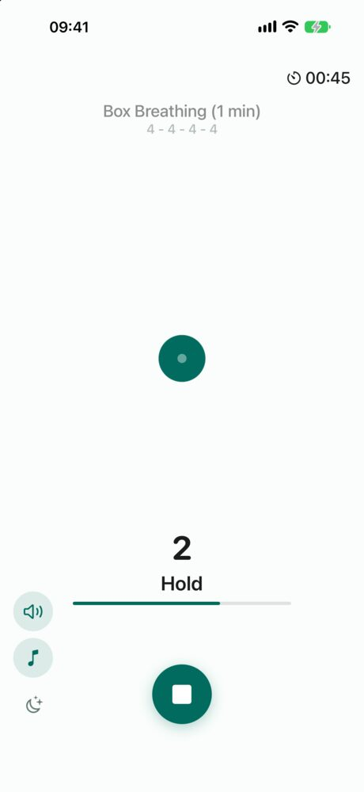

A box breathing app counts the four sides of the box for you: breathe in for 4 seconds, hold for 4, breathe out for 4, hold for 4. Deep Breath does this for free on iPhone and Android, with no ads and no account.

<figure><figcaption>Lungs full: the petals are open, hold for 4</figcaption></figure>
<figure><figcaption>Lungs empty: the petals are closed, hold again</figcaption></figure>

## How to start a box breathing timer

We make [Deep Breath](/apps/deep-breath/). Box breathing is one of its five built-in patterns.

1. Open **Settings** in the app and choose **Box Breathing** as the breathing method.
2. Choose a session length. The shortest is 1 minute, and you can also leave it unlimited.
3. Go back and press the start button. Breathe with the petals.

The petals open as you breathe in and close as you breathe out. The word below them says what to do, and the number shows how many seconds are left. Sound and vibration mark each step too, which helps if you would rather close your eyes.

## How long should you do box breathing?

One round takes 16 seconds, so a 1-minute session is a little under four rounds. Cleveland Clinic suggests [three to four rounds, once or twice a day](https://health.clevelandclinic.org/box-breathing-benefits). Breathe gently and don't strain.

Not everyone finds holding the breath comfortable. Medical News Today advises people who are pregnant or have high blood pressure to [talk to a doctor first](https://www.medicalnewstoday.com/articles/321805). If you feel dizzy, stop and breathe normally.

## Box breathing vs 4-7-8

| | Box breathing | 4-7-8 |
|---|---|---|
| Breathe in | 4 s | 4 s |
| Hold | 4 s | 7 s |
| Breathe out | 4 s | 8 s |
| Hold again | 4 s | none |
| One round | 16 s | 19 s |

Box breathing is even on every side, so it is easy to follow. 4-7-8 has a longer hold and a long exhale, and many people use it before sleep. Both are free in Deep Breath. Here is [how 4-7-8 breathing works](/apps/deep-breath/how-to/).

## What is free, and what is not

| | Free | Plus |
|---|---|---|
| Box breathing 4-4-4-4 and four other patterns | ✓ | ✓ |
| Every session length, history, reminders | ✓ | ✓ |
| Background sounds | 4 | 17 |
| Keeps going with the screen off | ✗ | ✓ |
| Your own timing, like 5-5-5-5 | ✗ | ✓ |
| Home Screen widget | ✗ | ✓ |
| Apple Watch app | ✗ | ✓ |

Without Plus, the screen stays on during a session. If you lock the phone or leave the app, the session ends. Plus is a one-time purchase, not a subscription.

## Does box breathing work on Apple Watch?

Yes. The Deep Breath watch app has the same box breathing pattern. It is part of Plus and needs watchOS 10 or later.
