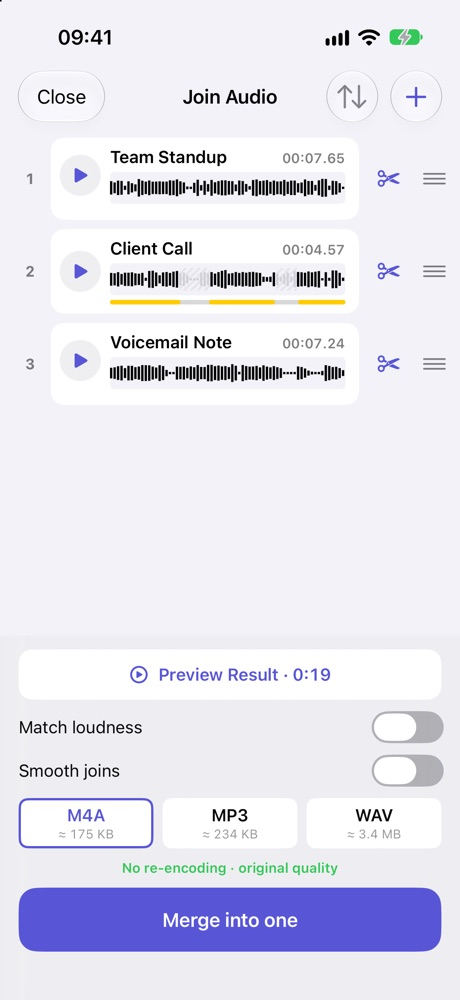
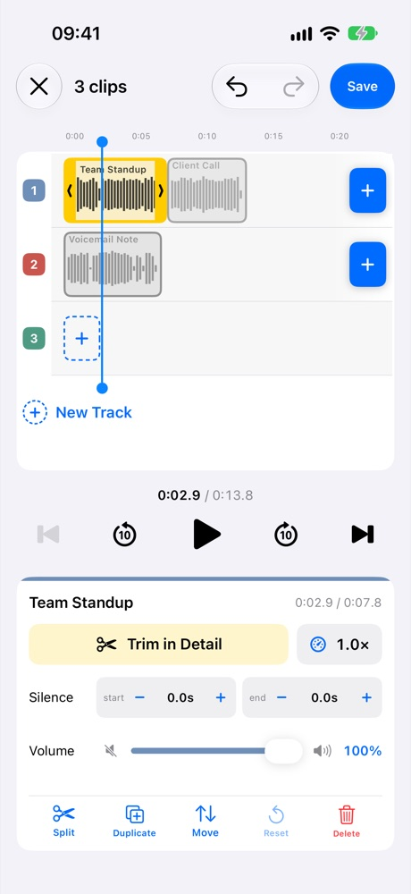

There are two ways to combine audio files on an iPhone, and they are not the same job.

Back to back

IntroInterviewOutro

One plays, then the next. The file is as long as all the parts added up.

Layered

Voice

Background music

Two sounds play at the same time. The music runs under the voice.

We make an app for each: [JoinSound](/apps/joinsound/) for back to back, and [AudioJoin](/apps/audiojoin/) for layering. Here are the same three recordings opened in both.

<figure><figcaption>JoinSound: a list, top to bottom</figcaption></figure>
<figure><figcaption>AudioJoin: tracks, left to right</figcaption></figure>

## JoinSound vs AudioJoin at a glance

| | JoinSound | AudioJoin |
|---|---|---|
| How you arrange | A list, top to bottom | Tracks on a timeline |
| Two sounds at the same time | ✗ | ✓ on separate tracks |
| Trim the start and end | ✓ | ✓ |
| Cut out a middle part | ✓ | ✓ (Split) |
| Shorten long silences | ✓ Plus | ✓ Plus |
| Even out the volume | One switch for every file | A slider on each clip |
| Fade where parts meet | ✓ Smooth joins | ✗ |
| Change a clip's speed | ✗ | ✓ 0.5x to 2x |
| Add a gap before or after a clip | ✗ | ✓ |
| Hear the result before saving | ✓ | ✓ |
| Save as | M4A, MP3, WAV | M4A, MP3, WAV |

JoinSound does fewer things, on purpose. Everything on its screen is about getting one clean file out of several.

## How to combine audio files on iPhone, one after another

There is nothing to place on a timeline: the order of the list is the order of the file.

1. Open JoinSound and pick your recordings, or share them in from another app.
2. Drag the rows into order. Tap the scissors on a row to trim it on the waveform.
3. Tap **Preview Result** to hear the whole thing.
4. Pick M4A, MP3 or WAV, and tap **Merge into one**.

Three switches cover what usually goes wrong when recordings are joined:

| Problem | Switch | What it does |
|---|---|---|
| One file is much quieter | Match loudness | Evens out the volume between files |
| A click where files meet | Smooth joins | Adds a short fade at each join |
| Long pauses | Shorten silences | Takes out long gaps. *Natural* leaves short pauses alone, *Tight* cuts closer |

When your files share the same format and nothing needs changing, M4A is saved without re-encoding, so the audio keeps its original quality.

## How to layer audio on iPhone

Layering needs a timeline, because you have to say *when* each sound starts. That is what AudioJoin is for.

1. Open AudioJoin and add your recordings. Each one becomes a block on a track.
2. Put the voice on one track and the music on another. Blocks that line up vertically play at the same time.
3. Drag a block to slide it in time, and pull its edges to trim it. Its own volume slider lets the music sit under the voice instead of over it.
4. Save as one file in M4A, MP3 or WAV.

Because every clip is its own block, each one can be set on its own:

| Per clip | Range |
|---|---|
| Volume | 0 to 100% |
| Speed | 0.5x to 2x, pitch stays the same |
| Silence before and after | In 0.1 second steps |
| Split, duplicate, delete | One tap each |

AudioJoin can join files back to back too: put them all on one track. But if that is all you need, the extra controls are in the way, and JoinSound gets you there in fewer taps.

## Which one should you use?

| You want to... | JoinSound | AudioJoin |
|---|---|---|
| Turn several recordings into one file | ✓ | |
| Put an intro and an outro around a recording | ✓ | |
| Fix one quiet file among loud ones | ✓ | |
| Put a voice over background music | | ✓ |
| Make one clip quieter or slower than the rest | | ✓ |
| Start a sound partway through another | | ✓ |

A simple test: if you could describe the result as "this, then this, then this", use JoinSound. If you need the word "while", as in "the music plays while I talk", use AudioJoin.

## What is free?

| | Free | Plus (one-time purchase) |
|---|---|---|
| Files you can combine | 2 | 3 or more |
| Trim | ✓ | ✓ |
| Shorten silences | | ✓ |
| Save as | M4A | M4A, MP3, WAV |
| Ads | None | None |

The table is the same for both apps. Plus is bought separately in each, and it is not a subscription.

Both run on iPhone, iPad and Android, and neither uploads your audio. Everything is processed on your device.
