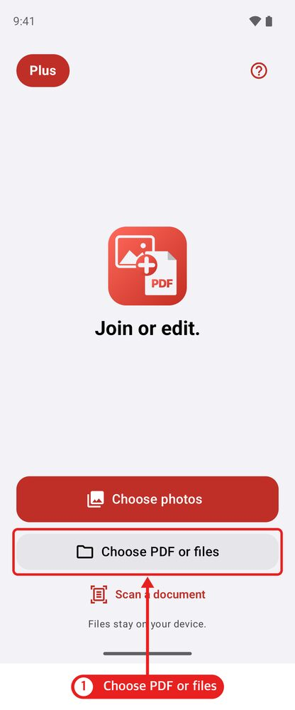
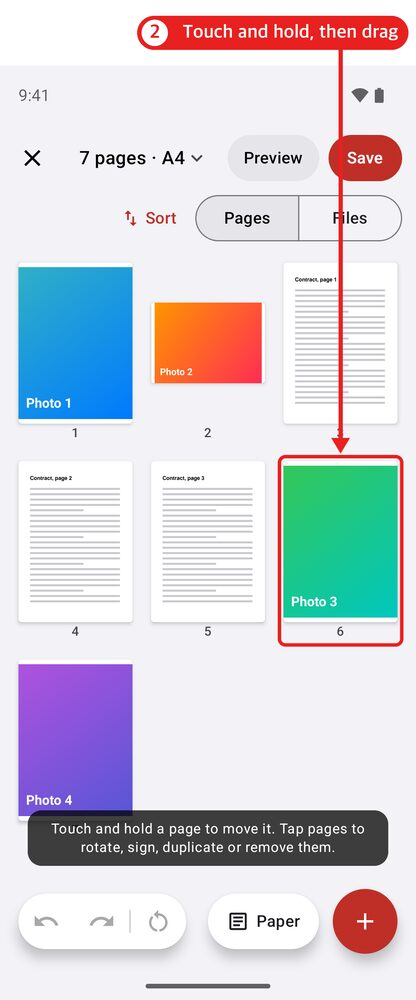
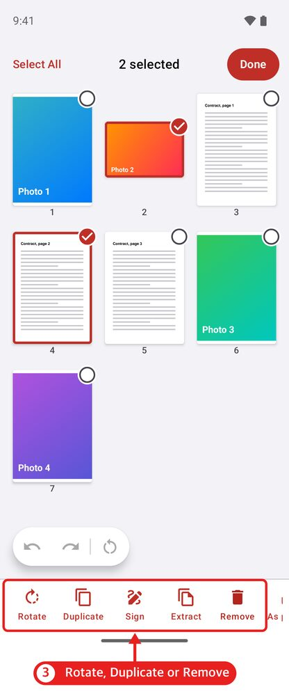
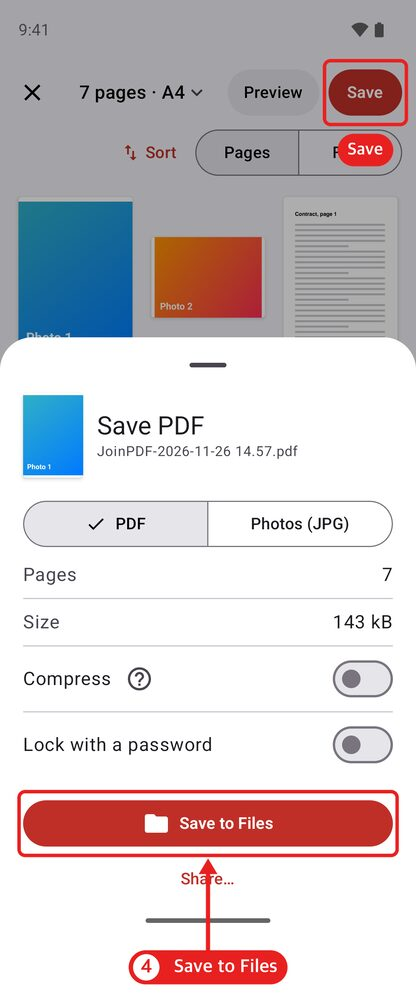
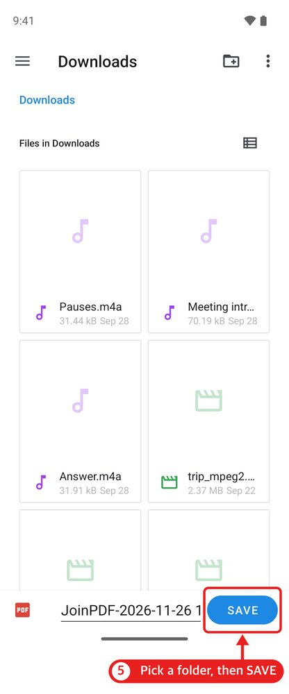
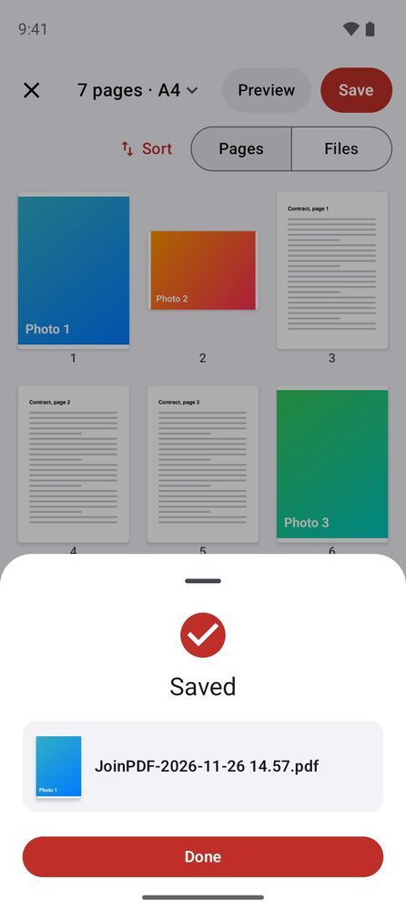

Android has no built-in way to join PDFs, so you need an app or a website. A website uploads your files; an app like JoinPDF puts PDFs and photos into one file on your phone, offline. Here is how.

## Can you merge PDFs on Android without an app?

Not with what comes on the phone. Android's file manager and Google Drive can open and share PDFs, but neither has a button that joins two of them into one.

That leaves two ways:

| | Online PDF merger | JoinPDF |
|---|---|---|
| Install anything | No | Yes |
| Your files are uploaded | Yes, to the site's server | No, they stay on your phone |
| Works offline | ✗ | ✓ |
| Photos in the same PDF | Some sites | ✓ straight from your gallery |
| Choose the order | Usually by file | By page |
| Move, rotate or remove single pages | Some sites | ✓ |
| Free | Often with a daily limit | ✓ up to 5 pages per PDF |

An online merger is fine for a menu or a public flyer. For a contract, a bank statement or a scan of your ID, you probably don't want a copy on someone else's server.

## How to combine PDF files on Android

We make [JoinPDF](/apps/joinpdf/) for this.

1. Tap **Choose PDF or files** and pick your PDFs. **Choose photos** adds pictures from your gallery, and **＋** on the board adds more later.
2. Every page appears on one board, numbered. A three-page PDF becomes three pages you can move on their own. Touch and hold a page, then drag it where it belongs.
3. Tap pages to select them, then tap **Rotate**, **Duplicate** or **Remove** at the bottom. **Blank** adds an empty page.
4. Tap **Save**. The sheet shows the page count and file size. Turn on **Lock with a password** or **Compress** here if you need them, then tap **Save to Files**. **Share…** sends it straight to an email or chat instead.
5. Pick a folder, then tap **SAVE**.

<figure><figcaption>1. Choose PDF or files</figcaption></figure>
<figure><figcaption>2. Touch and hold a page, then drag</figcaption></figure>

<figure><figcaption>3. Select pages, then Rotate, Duplicate or Remove</figcaption></figure>
<figure><figcaption>4. Save, then Save to Files</figcaption></figure>

<figure><figcaption>5. Pick a folder, then SAVE</figcaption></figure>
<figure><figcaption>Saved as one PDF</figcaption></figure>

Have it on paper? **Scan a document** on the first screen takes the page with the camera, crops it, and puts it on the board like any other page.

## Photos and PDF pages are different sizes

A phone photo is taller and narrower than an A4 page, so a mixed PDF can look uneven. Under **Paper**, choose **A4** or **Letter** and a margin (**None**, **Thin** or **Wide**), and every page is placed on the same size of paper. **Original** keeps each page as it was.

## Can I merge a password-protected PDF?

Yes. When you add a locked PDF, JoinPDF asks for its password, then its pages join the others. The PDF you save does not carry that password. To lock the new one, turn on **Lock with a password** before you save. Anyone who opens it will need that password.

## Is it free?

Saving a PDF of up to 5 pages is free, with no ads and no sign-in. Making the file smaller and locking it with a password are free too.

JoinPDF Plus saves any number of pages. It is a 1-year plan or a one-time lifetime purchase.

JoinPDF also runs on iPhone and iPad, where you can also [make a PDF from photos without an app](/blog/make-pdf-from-photos-iphone/). On iPhone the Files app can do a simple merge on its own: see [how to combine PDF files on iPhone](/blog/combine-pdf-files-iphone/).
