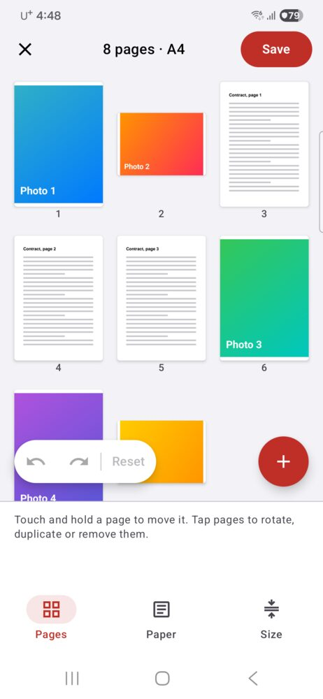
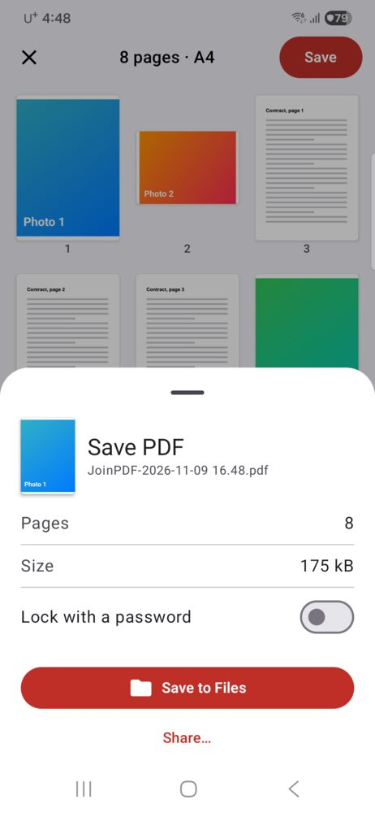

You have a few PDFs, maybe some photos of a receipt or an ID, and a form that takes one file. Here is how to put them together on an Android phone without sending them anywhere.

## Can you merge PDFs on Android without an app?

Not with what comes on the phone. Android's file manager and Google Drive can open and share PDFs, but neither has a button that joins two of them into one.

That leaves two ways:

| | Online PDF merger | JoinPDF |
|---|---|---|
| Install anything | No | Yes |
| Your files are uploaded | Yes, to the site's server | No, they stay on your phone |
| Works offline | ✗ | ✓ |
| Photos in the same PDF | Some sites | ✓ straight from your gallery |
| Choose the order | Usually by file | By page |
| Move, rotate or remove single pages | Some sites | ✓ |
| Free | Often with a daily limit | ✓ up to 3 pages per PDF |

An online merger is fine for a menu or a public flyer. For a contract, a bank statement or a scan of your ID, you probably don't want a copy on someone else's server.

## How to combine PDF files on Android

We make [JoinPDF](/apps/joinpdf/) for this.

<figure><figcaption>Every page of every file on one board</figcaption></figure>
<figure><figcaption>Check the page count and size, then save</figcaption></figure>

1. Tap **Choose PDF or files** and pick your PDFs. Tap **＋** later to add more, or **Choose photos** for pictures from your gallery.
2. Every page appears on one board, numbered. A three-page PDF becomes three pages you can move on their own.
3. Touch and hold a page, then drag it where it belongs.
4. Tap pages to select them, then **Rotate**, **Duplicate** or **Remove**. **Blank** adds an empty page.
5. Tap **Save**. The sheet shows the page count and file size. Tap **Save to Files** and pick a folder, or **Share…** to send it straight to an email or chat.

Have it on paper? **Scan a document** on the first screen takes the page with the camera, crops it, and puts it on the board like any other page.

## Photos and PDF pages are different sizes

A phone photo is taller and narrower than an A4 page, so a mixed PDF can look uneven. Under **Paper**, choose **A4** or **Letter** and a margin (**None**, **Thin** or **Wide**), and every page is placed on the same size of paper. **Original** keeps each page as it was.

## Can I merge a password-protected PDF?

Yes. When you add a locked PDF, JoinPDF asks for its password, then its pages join the others. The PDF you save does not carry that password. To lock the new one, turn on **Lock with a password** before you save. Anyone who opens it will need that password.

## Is it free?

Saving a PDF of up to 3 pages is free, with no ads and no sign-in. Opening and locking PDFs with a password is free too.

JoinPDF Plus saves any number of pages and adds the smallest file size. It is a 1-year plan or a one-time lifetime purchase.

JoinPDF also runs on iPhone and iPad. On iPhone the Files app can do a simple merge on its own: see [how to combine PDF files on iPhone](/blog/combine-pdf-files-iphone/).
