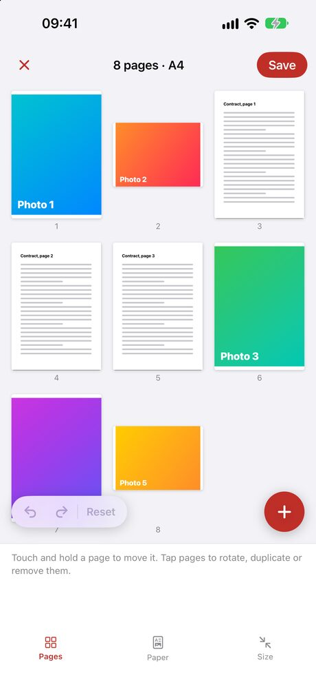
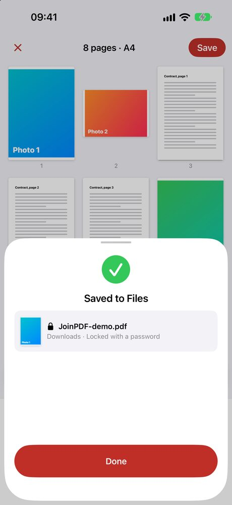

You have two or three PDFs, maybe a few photos of a receipt or an ID, and you need to send one file. The iPhone can do part of this on its own. Here is the free way first, and where it stops.

## Can you combine PDFs on iPhone without an app?

Yes. The Files app has a **Create PDF** action that joins the files you select into one new PDF.

1. Open **Files** and put the PDFs in the same folder.
2. Tap **⋯** at the top right, then **Select**, and tap each file.
3. Tap **⋯** at the bottom right, then **Create PDF**.

The new PDF appears in the same folder. Your original files stay where they were.

It works for photos too, if they are saved in Files. Photos in the Photos app have to be saved to Files first.

## The catch: you don't choose the order

Files joins the documents in the order they are listed in the folder, usually by name, not in the order you tapped them. To put them in a different order, you rename them first (`1 contract`, `2 receipt`, ...).

There is also no page view before you create the PDF. You can't drop one page from the middle, turn a sideways scan, or move the last page to the front. You find out what you got by opening the result.

| | Files app | JoinPDF |
|---|---|---|
| Join PDFs | ✓ | ✓ |
| Photos in the same PDF | ✓ if saved in Files | ✓ straight from Photos |
| Choose the order | Rename the files | Drag the pages |
| Move, rotate or remove single pages | ✗ | ✓ |
| See every page before you save | ✗ | ✓ |
| Fit every page to A4 or Letter | ✗ | ✓ |
| Lock the result with a password | ✗ | ✓ |
| Free | ✓ | ✓ up to 3 pages per PDF |
| Files leave your iPhone | No | No |

If the files are already named in the right order and you need every page as it is, Files is enough.

## How to combine PDFs and photos page by page

We make [JoinPDF](/apps/joinpdf/) for the other case: when the order, or single pages, matter.

<figure><figcaption>Every page of every file on one board</figcaption></figure>
<figure><figcaption>Saved as one PDF, here with a password</figcaption></figure>

1. Tap **Choose PDF or files** for your PDFs, and **Choose photos** for pictures. **Scan a document** takes a paper page with the camera.
2. Every page appears on one board, numbered. A three-page PDF becomes three pages you can move on their own.
3. Touch and hold a page, then drag it where it belongs.
4. Tap pages to select them, then rotate, duplicate or remove them. **Blank** adds an empty page.
5. Tap **Save**, then **Save to Files**. Turn on the password switch first if the PDF should be locked.

Photos of different sizes can look messy next to document pages. Under **Paper**, choose A4 or Letter and a margin, and every page is placed on the same size of paper.

## Is it free?

Saving a PDF of up to 3 pages is free, with no ads and no sign-in. Opening a password-protected PDF and locking the one you save are free too.

JoinPDF Plus saves any number of pages. It is a 1-year plan or a one-time lifetime purchase.

## Are my files uploaded?

No. Online PDF mergers upload your documents to their server. JoinPDF reads and joins them on your iPhone, and the PDF goes only where you save or share it. That matters for contracts, IDs and anything with your address on it.

JoinPDF also runs on iPad and Android.
