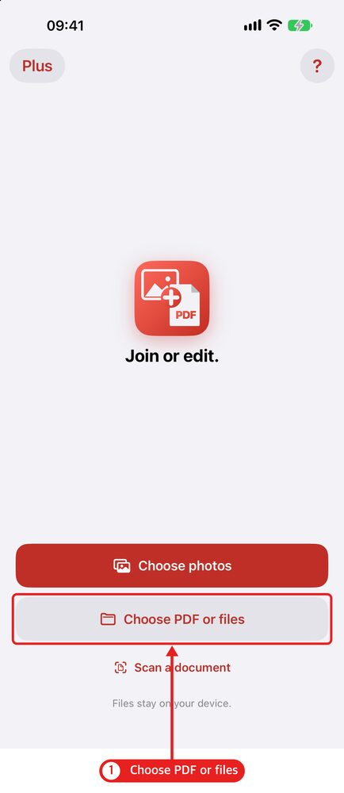
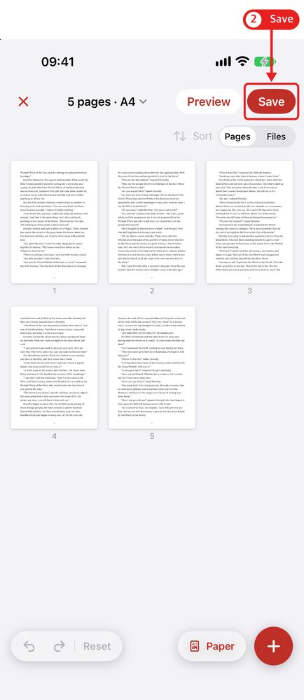
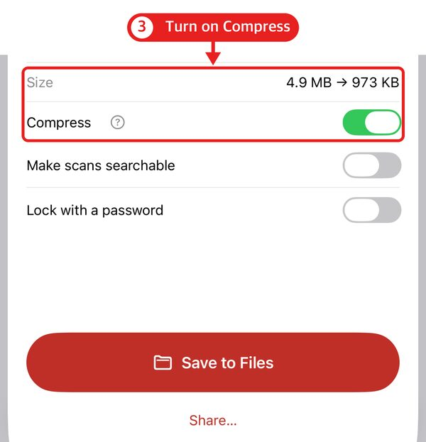
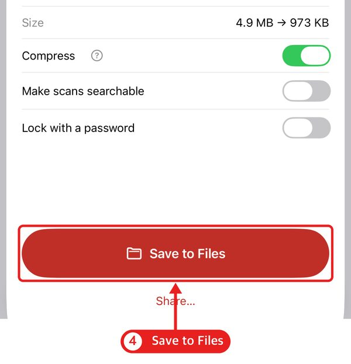
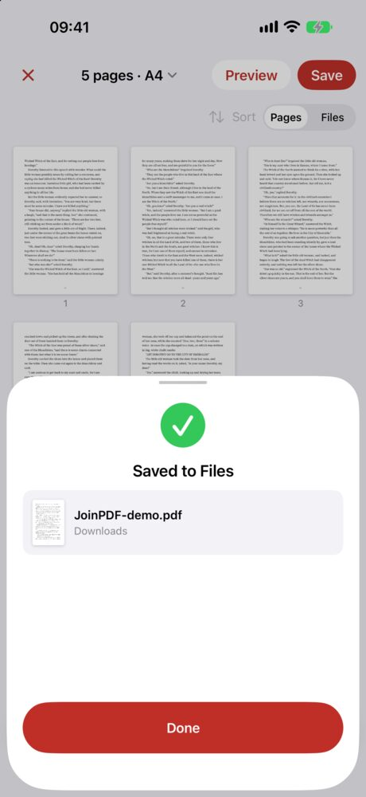

To compress a PDF on iPhone, you need an app or a shortcut: the Files app can't make a PDF smaller on its own. In [JoinPDF](/apps/joinpdf/) you open the PDF, tap **Save**, turn on **Compress**, and the sheet shows the size before and after. In our test a 5-page scan went from 4.9 MB to 973 KB.

## Why is my PDF so big?

Almost always because of pictures. A scanned page or a camera photo is a full-size image, often several megabytes each. A PDF of plain text, like one exported from Word, is usually small already.

So compressing a PDF really means making the pictures inside it smaller. Text and lines don't need it.

## Can you reduce PDF size on iPhone without an app?

Not well.

- **Files › Compress** makes a ZIP file. A PDF is already packed, so the ZIP is barely smaller, and the person you send it to has to unzip it.
- **Shortcuts** has an **Optimize File Size of PDF** action. Users report it often leaves the file almost the same size, because it keeps the pictures at full resolution.

If the file has to get under a real limit, like 2 MB on an upload form, you need something that shrinks the pictures.

## How to compress a PDF on iPhone

1. Open JoinPDF and tap **Choose PDF or files**, then pick the PDF. You can add more than one, and photos too.
2. Every page appears on the board. Tap **Save** at the top right.
3. Turn on **Compress**. The **Size** line changes to before → after, here 4.9 MB → 973 KB.
4. Tap **Save to Files**. **Share…** sends it straight to Mail or a chat instead.

<figure><figcaption>1. Choose PDF or files</figcaption></figure>
<figure><figcaption>2. Save</figcaption></figure>

<figure><figcaption>3. Turn on Compress: Size 4.9 MB → 973 KB</figcaption></figure>
<figure><figcaption>4. Save to Files</figcaption></figure>

<figure><figcaption>Saved to Files</figcaption></figure>

Your original PDF stays as it was. The smaller one is a new file.

## Will the PDF look worse?

Text in a normal PDF stays sharp, because it isn't a picture. What changes are the pictures: photos and scanned pages are resized to 1600 pixels on the long side and saved again. A scanned page of a book still reads clearly at that size.

If a PDF can't get any smaller, JoinPDF tells you and keeps it as it is. That happens with PDFs that are mostly text.

## How to make a scanned PDF smaller

Scans are where compression helps most, because every page is a photo. The steps are the same as above. If you scan with **Scan a document** in JoinPDF, you can turn on **Compress** before you save it the first time.

Making a PDF from camera photos gives the same problem: see [how to make a PDF from photos on iPhone](/blog/make-pdf-from-photos-iphone/).

## Is it free?

Compress is free, with no ads and no sign-in. Saving a PDF of up to 5 pages is free. A longer PDF needs JoinPDF Plus, a 1-year plan or a one-time lifetime purchase, or you can save the first 5 pages for free.

## Is my PDF uploaded?

No. Online PDF compressors upload your file to their server. JoinPDF compresses it on your iPhone, and the PDF goes only where you save or share it.

Need to put several PDFs into one before you send it? See [how to combine PDF files on iPhone](/blog/combine-pdf-files-iphone/).
