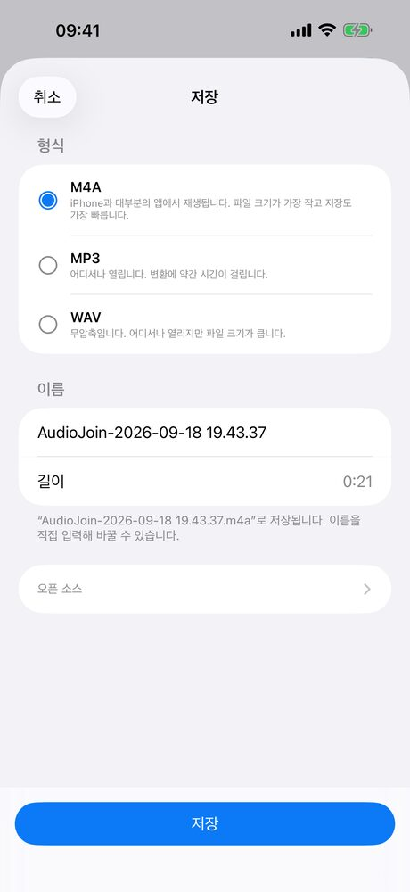
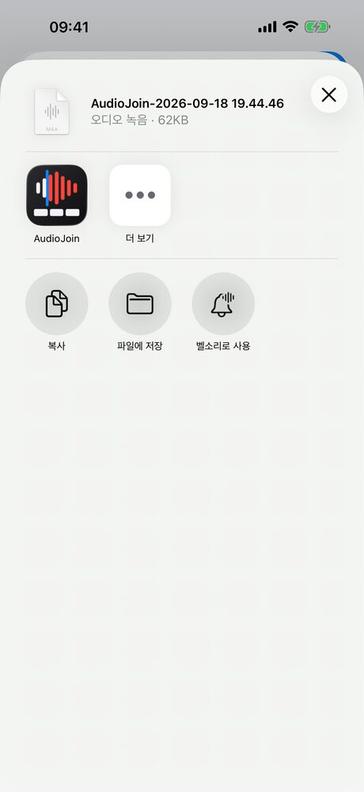

m4a를 mp3로 **바꾸기만 하면 된다면** 브라우저에서 도는 무료 변환기로 충분합니다. **앞뒤를 자르거나 여러 개를 합쳐서** 바꿔야 한다면 앱이 편합니다.

아이폰 음성 메모는 m4a로 저장됩니다. 음성 메모 앱에는 mp3로 저장하는 기능이 없습니다.

## m4a mp3 변환 방법 비교

| 방법 | 쓰는 곳 | 비용 | 자르기·합치기 |
|---|---|---|---|
| 브라우저 변환기 (iTool) | 폰, PC | 무료 | ✗ |
| 앱 (AudioJoin) | 아이폰, 안드로이드 | mp3는 Plus | ✓ |
| 음악 앱 | 맥 | 무료 | ✗ |

셋 다 녹음이 서버로 올라가지 않습니다. 인터넷에 있는 변환 사이트는 파일을 서버로 보내는 곳이 많습니다. 회의나 상담 녹음이라면 파일을 올리는 방식인지 먼저 확인합니다.

## m4a mp3 변환 무료 사이트, 올리지 않고 바꾸기

저희가 만든 [iTool MP3 변환기](https://itool.co.kr/util/mp4-to-mp3/)는 동영상용으로 만들었지만 m4a도 받습니다. 변환은 브라우저 안에서 끝나고 파일은 서버로 가지 않습니다.

1. 변환기를 열고 m4a 파일을 고릅니다. 아이폰 음성 메모는 먼저 **공유 > 파일에 저장**으로 빼 둡니다.
2. 고르는 즉시 mp3로 바뀝니다. 20개까지 한 번에 넣을 수 있습니다.
3. 들어 보고 **MP3 다운로드**를 누릅니다.

파일 하나에 200MB까지 받습니다. 긴 녹음은 폰 메모리가 모자랄 수 있으니 한 시간이 넘으면 컴퓨터에서 바꿉니다.

## 자르거나 합쳐서 mp3로 저장하기

앞쪽 잡음을 잘라 내거나 나눠 녹음한 파일을 하나로 만들어야 한다면 [AudioJoin](/ko/apps/audiojoin/)을 쓰면 됩니다.

<figure><figcaption>저장할 때 MP3를 고릅니다. MP3와 WAV는 Plus입니다</figcaption></figure>
<figure><figcaption>공유 시트에서 파일에 저장을 누릅니다</figcaption></figure>

1. 음성 메모에서 **공유**를 누르고 **Add to AudioJoin**을 고릅니다. AudioJoin을 열어 **오디오 선택**으로 m4a 파일을 골라도 됩니다.
2. 필요하면 앞뒤를 자릅니다. 여러 개를 넣으면 순서대로 이어집니다.
3. **저장**을 누르고 형식에서 **MP3**를 고릅니다.
4. 공유 시트가 열리면 **파일에 저장**을 누르거나 바로 보냅니다.

원본 녹음은 그대로 남고 mp3가 새로 만들어집니다.

| | 무료 | AudioJoin Plus |
|---|---|---|
| 자르기 | ✓ | ✓ |
| 하나로 합치는 개수 | 2개 | 3개 이상 |
| 저장 형식 | M4A | M4A, MP3, WAV |

아이폰과 아이패드는 1년 구독 또는 평생 이용권이고, 안드로이드는 한 번 구매입니다. 광고는 없습니다.

## 맥에서 m4a를 mp3로 바꾸기

맥이 있으면 음악 앱으로 무료로 바꿉니다. 자세한 순서는 [Apple 안내](https://support.apple.com/ko-kr/120493)에 있습니다.

1. 음악 앱에서 **음악 > 설정 > 파일 > 가져오기 설정**을 열고 **MP3 인코더**를 고릅니다.
2. m4a 파일을 음악 앱으로 끌어다 놓습니다.
3. 파일을 고르고 **파일 > 변환 > MP3 버전 생성**을 누릅니다.

## 꼭 mp3로 바꿔야 할까

아닐 때가 많습니다. m4a는 아이폰, 갤럭시, 맥, 윈도우에서 대부분 재생됩니다. 제출 사이트나 오래된 기기가 mp3만 받을 때 바꾸면 됩니다.

## m4a를 mp3로 바꾸면 음질 차이가 있나

조금 떨어집니다. 둘 다 압축 형식이라 바꿀 때 한 번 더 압축되기 때문입니다. 말소리 녹음이라면 차이를 듣기 어렵습니다.

AudioJoin은 모노 녹음을 128kbps, 스테레오를 192kbps로 만듭니다. iTool은 모노 96kbps, 스테레오 192kbps입니다. 원본 m4a는 지우지 말고 남겨 두는 편이 좋습니다.
