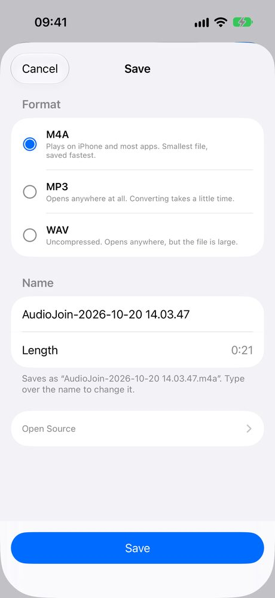
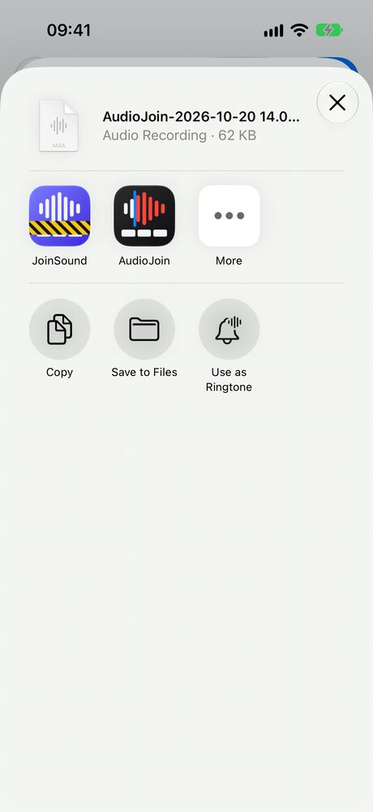

The iPhone can't save a voice memo as MP3 by itself, so you need an app, a website, or a Mac. Voice Memos records M4A files, and the Shortcuts app only encodes audio to M4A or AIFF. Here is what each way costs and what gets uploaded.

<figure><figcaption>Pick MP3 when you save. MP3 and WAV are Plus options.</figcaption></figure>
<figure><figcaption>The share sheet opens on its own. Tap Save to Files.</figcaption></figure>

## Do you need an MP3?

Often not. An M4A voice memo plays on iPhone, Android, Mac and Windows, and most apps and websites take it. Convert it when something asks for MP3 by name, like an upload form or an older player that only reads MP3.

## Can you convert a voice memo to MP3 on iPhone for free?

Not on the iPhone alone. These are your options:

| | Shortcuts | Online converter | Music app on Mac | AudioJoin |
|---|---|---|---|---|
| Makes an MP3 | ✗ (M4A or AIFF only) | ✓ | ✓ | ✓ |
| Works on iPhone alone | ✓ | ✓ | ✗ | ✓ |
| Free | ✓ | Usually, with limits | ✓ | Saving as MP3 needs Plus |
| Recording is uploaded | No | Yes | No | No |

If the memo is private, like a meeting, a lecture or a doctor's appointment, think twice before uploading it to a converter site.

## How to convert a voice memo to MP3 with AudioJoin

1. In Voice Memos, open the recording and tap the **Share** button. Pick **Add to AudioJoin**. If you don't see it, tap **More** at the end of the app row. Tap **Done** when it says the memo was added.
2. Open AudioJoin. The memo is on the timeline. If you want to cut a false start or a long pause at the end, tap **Trim in Detail** first.
3. Tap **Save**, choose **MP3** under Format, and change the name if you like.
4. Tap **Save**. When the share sheet opens, tap **Save to Files**, or send the MP3 straight to a message or mail.

Your original voice memo stays as it is. The MP3 is a new file.

## How to convert a voice memo to MP3 on a Mac

If you have a Mac, the Music app can do it for free. [Apple's steps](https://support.apple.com/en-us/120493), in short:

1. Get the memo onto the Mac: AirDrop it from the iPhone, or, if Voice Memos syncs through iCloud, drag it out of the Voice Memos app on the Mac.
2. In Music, choose **Music** > **Settings**, click **Files**, then **Import Settings**, and set **Import Using** to **MP3 Encoder**.
3. Drag the memo from Finder into Music, select it, and choose **File** > **Convert** > **Create MP3 Version**.

The MP3 appears in your library next to the original. **File** > **Show in Finder** takes you to the file.

## Does converting to MP3 lower the quality?

A little, because M4A and MP3 are both compressed formats and converting means compressing again. AudioJoin makes a 128 kbps MP3 from a mono voice memo and 192 kbps from a stereo one. For speech, that is hard to tell apart from the original.

If you don't need MP3 specifically, saving as M4A skips the second compression.

## Is it free?

| | Free | AudioJoin Plus |
|---|---|---|
| Trim | ✓ | ✓ |
| Clips joined into one file | 2 | 3 or more |
| Save as | M4A | M4A, MP3, WAV |

On iPhone and iPad, Plus is a 1-year plan or a one-time lifetime purchase. There are no ads and no sign-in.

## Can I turn several voice memos into one MP3?

Yes. Share each memo to AudioJoin, put them in order, and save once as MP3. Joining three or more needs Plus, the same as MP3. For other ways to join them, see [how to combine voice memos into one recording](/blog/merge-voice-memos-iphone/). If the sound you need is inside a video instead, see [how to extract audio from a video on iPhone](/blog/extract-audio-from-video-iphone/).
