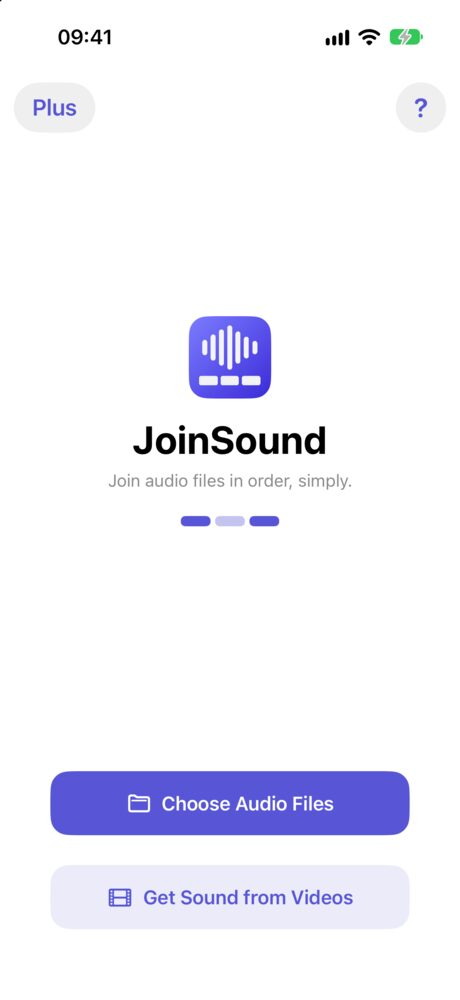
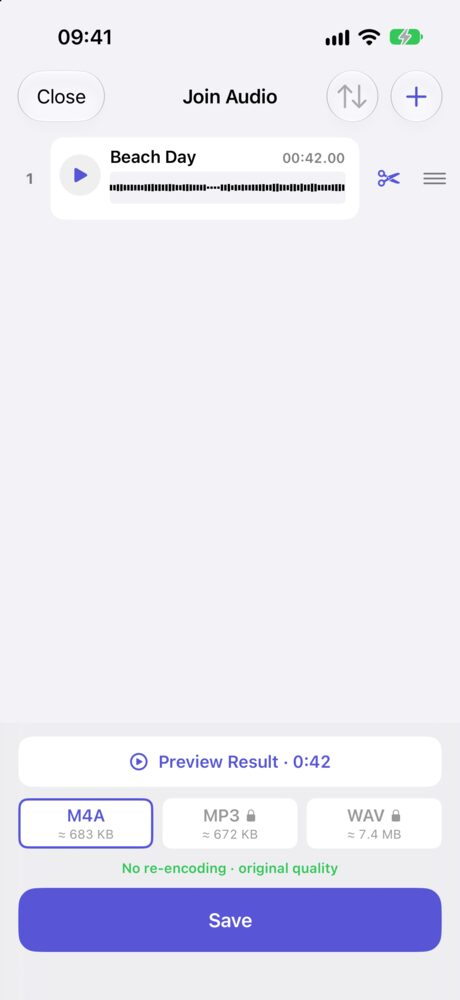

You have a video on your iPhone and you only want its sound: a talk, a lesson, a song someone played at a party. The iPhone has no button for this, but there are three ways to do it. The Shortcuts app is free and built in. An app takes fewer steps. Here is how each one works.

<figure><figcaption>Get Sound from Videos opens your Photos library</figcaption></figure>
<figure><figcaption>A video becomes an audio file, ready to trim and save</figcaption></figure>

## Can you extract audio from a video on iPhone without an app?

Yes, with the Shortcuts app or a website. Each way has a catch:

| | Shortcuts | Online converter | JoinSound |
|---|---|---|---|
| Nothing to install | ✓ | ✓ | ✗ |
| Setup | Build the shortcut once | None | None |
| Video leaves your iPhone | No | Usually, it is uploaded | No |
| Free | ✓ | Usually, with limits | ✓ as M4A |

If you only need this once and don't mind sending the video to a website, an online converter is the quickest. If the video is private, use one of the other two.

## How to extract audio with the Shortcuts app

The usual recipe, [as How-To Geek lays it out](https://tech.yahoo.com/apps/articles/extract-audio-video-file-iphone-141515248.html):

1. Open **Shortcuts** and tap **+** to make a new shortcut.
2. Turn on **Show in Share Sheet**, and set the shortcut to receive only **Media**.
3. Add the **Encode Media** action and turn on **Audio Only**.
4. Add the **Save File** action and tap **Done**.
5. In Photos, open a video, tap **Share**, and run your shortcut.

### What if the shortcut stopped working?

You are not alone. Since iOS 26, people on Apple's forums have reported that this shortcut [no longer saves anything](https://discussions.apple.com/thread/256185382), or that it [finishes in a second and the file never appears](https://discussions.apple.com/thread/256191669), even after they rebuild it. If that happens to you, try one of the other ways instead of rebuilding it again.

## How to extract audio from a video with an app

1. Open JoinSound and tap **Get Sound from Videos**. Your Photos library opens, showing only videos.
2. Pick a video. JoinSound takes the sound and drops the picture, so a new row appears with a waveform.
3. Tap the scissors on the row if you want only part of it.
4. Tap **Preview Result** to listen, then tap **Save**.

A video saved in Files works too. Tap **Choose Audio Files** and pick it there, or share it to JoinSound from Files.

This only works on video files. It can't take a link from YouTube or Instagram. The video needs to be on your iPhone first.

## Does extracting audio lower the quality?

Usually not. iPhone videos normally store their sound as AAC, the same format an M4A file uses, so JoinSound copies the sound as it is. The screen says **No re-encoding · original quality** when it does. If a video's sound is in another format, JoinSound converts it to AAC.

## Can you save it as MP3?

Yes, with JoinSound Plus. Saving as M4A is free, and it is what iPhone's own Voice Memos use. MP3 and WAV come with Plus, for the times something asks for those formats specifically.

| | Free | JoinSound Plus |
|---|---|---|
| Sound from a video | ✓ | ✓ |
| Trim | ✓ | ✓ |
| Files in one result | 2 | 3 or more |
| Save as | M4A | M4A, MP3, WAV |

On iPhone, Plus is a 1-year plan or a one-time lifetime purchase.

## Is my video uploaded?

Not with JoinSound. There is no account, and the sound is taken out on your iPhone. The video in your Photos library stays as it was.

Have several clips? Add them all and JoinSound joins their sound into one file, the same way it [merges voice memos](/blog/merge-voice-memos-iphone/).
