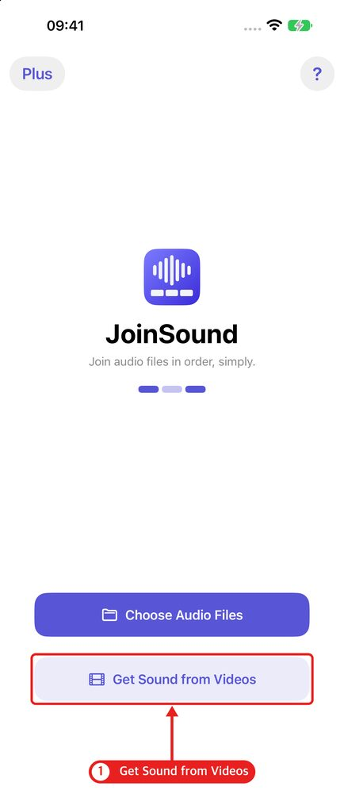
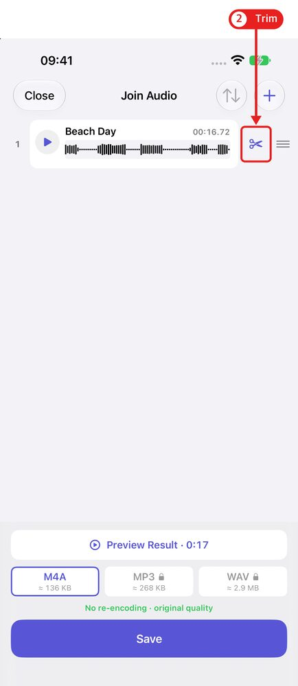
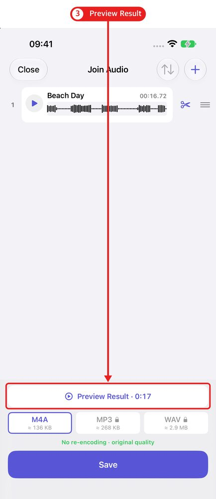
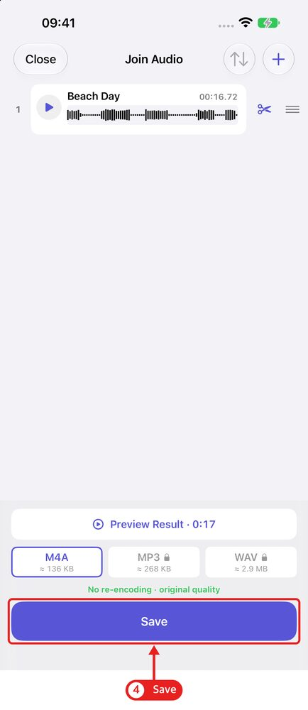
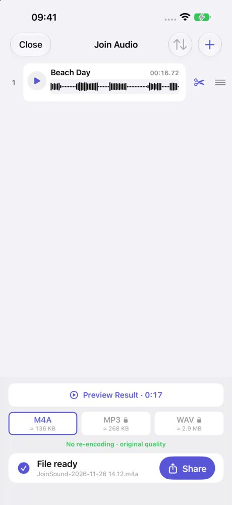

The iPhone has no button that turns a video into audio, but there are three ways to do it: a Shortcut you build once in the Shortcuts app, an online converter, or an app like JoinSound. The Shortcut is free and built in. An app takes fewer steps. Here is how each one works.

## Can you extract audio from a video on iPhone without an app?

Yes, with the Shortcuts app or a website. Each way has a catch:

| | Shortcuts | Online converter | JoinSound |
|---|---|---|---|
| Nothing to install | ✓ | ✓ | ✗ |
| Setup | Build the shortcut once | None | None |
| Video leaves your iPhone | No | Usually, it is uploaded | No |
| Free | ✓ | Usually, with limits | ✓ as M4A |

If you only need this once and don't mind sending the video to a website, an online converter is the quickest. If the video is private, use one of the other two.

## How to extract audio with the Shortcuts app

The usual recipe, [as How-To Geek lays it out](https://tech.yahoo.com/apps/articles/extract-audio-video-file-iphone-141515248.html):

1. Open **Shortcuts** and tap **+** to make a new shortcut.
2. Turn on **Show in Share Sheet**, and set the shortcut to receive only **Media**.
3. Add the **Encode Media** action and turn on **Audio Only**.
4. Add the **Save File** action and tap **Done**.
5. In Photos, open a video, tap **Share**, and run your shortcut.

### What if the shortcut stopped working?

You are not alone. Since iOS 26, people on Apple's forums have reported that this shortcut [no longer saves anything](https://discussions.apple.com/thread/256185382), or that it [finishes in a second and the file never appears](https://discussions.apple.com/thread/256191669), even after they rebuild it. If that happens to you, try one of the other ways instead of rebuilding it again.

## How to extract audio from a video with an app

1. Open JoinSound and tap **Get Sound from Videos**. Your Photos library opens, showing only videos. Pick one. JoinSound takes the sound and drops the picture, so a new row appears with a waveform.
2. Tap **Trim** (the scissors) on the row if you want only part of it. Long pauses can be [shortened there too](/blog/remove-silence-from-audio/).
3. Tap **Preview Result** to listen.
4. Tap **Save**. The share sheet opens with the new audio file: pick **Save to Files**, or send it straight to another app.

<figure><figcaption>1. Get Sound from Videos</figcaption></figure>
<figure><figcaption>2. Trim (the scissors), if you need only part</figcaption></figure>

<figure><figcaption>3. Preview Result</figcaption></figure>
<figure><figcaption>4. Save</figcaption></figure>

<figure><figcaption>The sound is now an M4A file. Tap Share to send it again</figcaption></figure>

A video saved in Files works too. Tap **Choose Audio Files** and pick it there, or share it to JoinSound from Files.

This only works on video files. It can't take a link from YouTube or Instagram. The video needs to be on your iPhone first.

## Does extracting audio lower the quality?

Usually not. iPhone videos normally store their sound as AAC, the same format an M4A file uses, so JoinSound copies the sound as it is. The screen says **No re-encoding · original quality** when it does. If a video's sound is in another format, JoinSound converts it to AAC.

## Can you save it as MP3?

Yes, with JoinSound Plus. Saving as M4A is free, and it is what iPhone's own Voice Memos use. MP3 and WAV come with Plus, for the times something asks for those formats specifically. If what you have is a voice memo, not a video, see [how to convert a voice memo to MP3](/blog/convert-voice-memo-to-mp3-iphone/).

| | Free | JoinSound Plus |
|---|---|---|
| Sound from a video | ✓ | ✓ |
| Trim | ✓ | ✓ |
| Files in one result | 2 | 3 or more |
| Save as | M4A | M4A, MP3, WAV |

On iPhone, Plus is a weekly or yearly plan, or a one-time lifetime purchase. On Android it is a one-time purchase.

## Is my video uploaded?

Not with JoinSound. There is no account, and the sound is taken out on your iPhone. The video in your Photos library stays as it was. To shorten the video itself, see [how to trim a video on iPhone](/blog/trim-video-iphone/).

Have several clips? Add them all and JoinSound joins their sound into one file, the same way it [merges voice memos](/blog/merge-voice-memos-iphone/).
