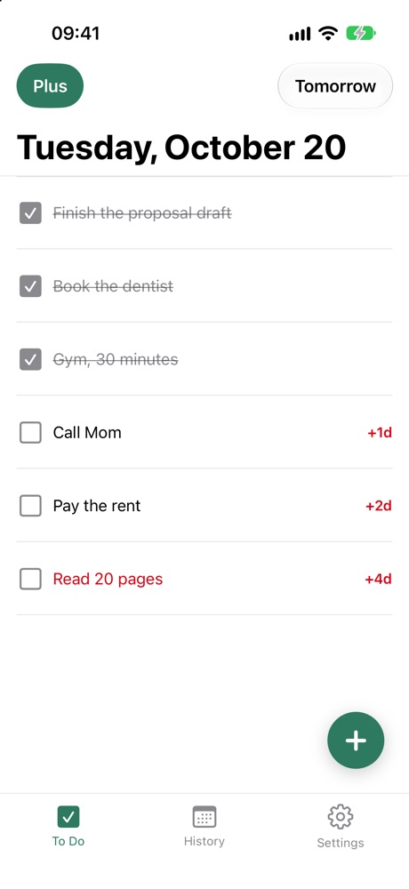
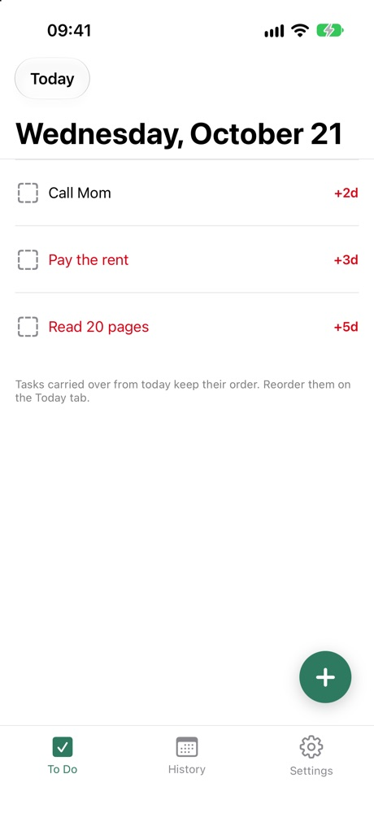

If your to-do list keeps growing and the important things keep sliding, the fix is not a better list. It is a shorter one.

The Ivy Lee Method is a way of planning your day that has been in use for over a hundred years. It fits in five lines, and the whole of it is a limit: six tasks, in order.

## What is the Ivy Lee Method?

At the end of the day, write down the six things you need to get done tomorrow. No more than six.

Put them in order of real importance, most important first.

Tomorrow, start at the top. Work on that one task until it is done, then move to the second.

Whatever you do not finish moves onto the next day's list, and you rank it again with the rest.

Repeat it every working day.

## What is the main principle behind the Ivy Lee Method?

Two things, and neither is about working faster.

The first is the limit. A list of thirty things is not a plan, it is an inventory. When you can only write six, you are forced to decide what actually matters, and the deciding is the work most people skip.

The second is the order. Once the list is ranked, you never have to ask "what should I do now?" again. You already answered that yesterday, when you were calm. The answer is: the top one.

## Why six?

Six is small enough that you have to leave things out, and large enough to hold a real day. There is nothing magic about the number. The magic is in being unable to add a seventh.

If six still feels like too many, rank them properly and you will find the last two never mattered.

## What do you do with the tasks you do not finish?

You carry them over, without guilt. An unfinished task is not a failure, it is simply on tomorrow's list.

This is also where the method quietly reports on you. A task that keeps moving forward day after day is telling you something: it is too big to be one task, it is not actually important, or you are avoiding it. All three are useful to know, and you only notice when you can see how long it has been waiting.

## Doing it on paper, or in an app

Paper works. Ivy Lee had nothing else. The friction is that you rewrite the list every evening, and the list stays on the desk you left it on.

An app should do only the parts paper is bad at: carry the leftovers over for you, keep the list where you already look, and remember what you did months ago.

| | Paper | Ivy To Do |
|---|---|---|
| Unfinished tasks | Rewritten by hand every evening | Carried into tomorrow on their own |
| How long a task has waited | You have to remember | A badge on the task (+2d) |
| Where the list is | On the desk you left it on | On your Home Screen widget |
| Days you have done | Thrown away | A calendar with your streak |

That is what [Ivy To Do](/apps/ivy-todo/) is. Start with your six most important tasks (six is a suggestion, not a cap), drag them into order, and anything you did not check off is carried into tomorrow on its own, with a badge showing how many days it has waited. You plan tomorrow on its own tab in the evening, which is when the method says to do it.

<figure><figcaption>Today: what you did not finish shows how long it has waited</figcaption></figure>
<figure><figcaption>Tomorrow: the leftovers are already there, in order</figcaption></figure>

The list sits in a Home Screen widget, so it is in front of you without opening anything, and on iPhone you can check tasks off on the widget itself. An evening reminder brings you back to plan tomorrow. The calendar keeps every day you have done, with a monthly line: tasks done, perfect days and your current streak.

All of that is free, with no ads and no account.

## Start tonight, not tomorrow morning

The method only works if the list exists before the day starts. Write six things tonight, put the hardest one first, and tomorrow just start at the top.
