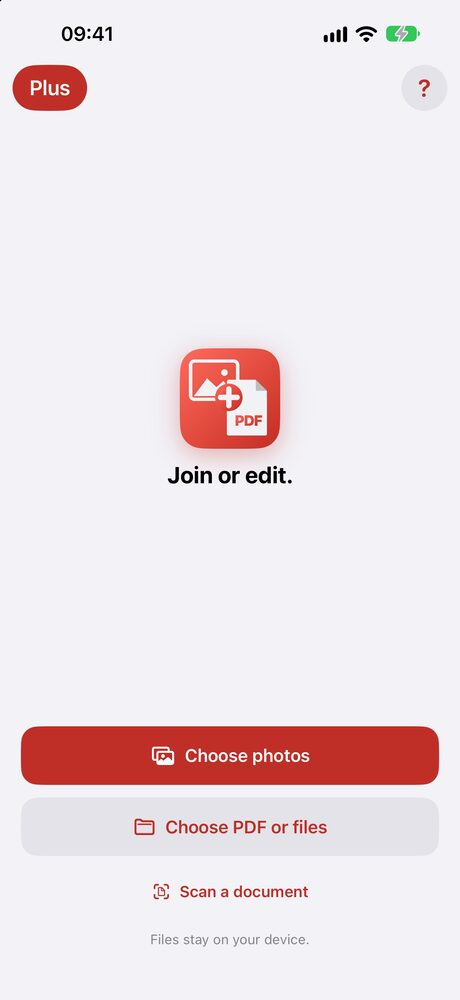
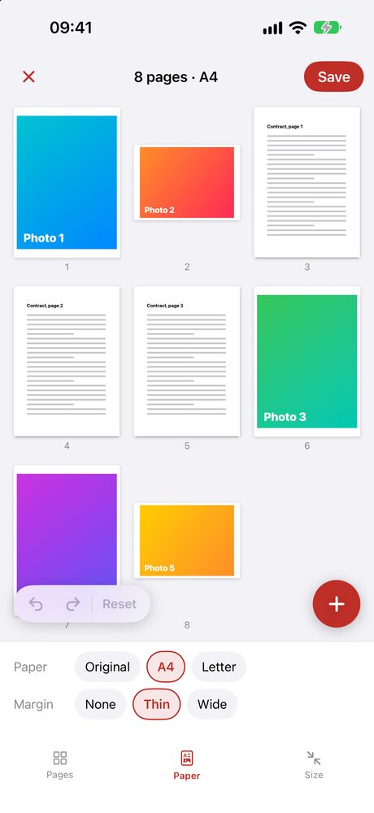

A form asks for a PDF, and what you have is photos: a receipt, both sides of an ID, a few pages of a document you shot on the table. Here is how to turn them into one PDF on iPhone, free first.

## How to make a PDF from photos without an app

There is no button called "Save as PDF" in Photos. The way in is the Print menu.

1. In **Photos**, tap **Select** and tap each picture you want, in the order you want them.
2. Tap the **Share** button, scroll down and tap **Print**.
3. In Print Options, tap the **Share** button at the top. Pick **Save to Files**, or send the PDF straight to Mail or a chat.

Each photo becomes one page. If you don't see a Share button in Print Options, spread two fingers on a page preview, and the preview opens as a PDF you can share.

There is a second free way: save the photos to the Files app, select them there, and tap **⋯** then **Create PDF**. That one orders the pages by file name, not by the order you tapped. See [how to combine PDF files on iPhone](/blog/combine-pdf-files-iphone/).

## Where the free way falls short

The Print trick is fine for one or two pictures. With more, a few things get in the way:

| | Print menu | JoinPDF |
|---|---|---|
| Many photos in one PDF | ✓ | ✓ |
| Change the order afterwards | Start over | Drag the pages |
| Rotate a sideways photo | Rotate it in Photos first | ✓ |
| Add an existing PDF to the photos | ✗ | ✓ |
| Same page size for every photo | Print paper size | A4, Letter or each photo's own size |
| Margin | Print margin | None, thin or wide |
| Make the file smaller | ✗ | ✓ |
| Lock with a password | ✗ | ✓ |
| Free | ✓ | ✓ up to 3 pages per PDF |
| Photos leave your iPhone | No | No |

Photos straight from the camera are large. Ten of them can make a PDF too big for an email or an upload form.

## How to make one PDF from many photos

We make [JoinPDF](/apps/joinpdf/) for this.

<figure><figcaption>Start with Choose photos</figcaption></figure>
<figure><figcaption>Paper: every photo on A4 with a thin margin</figcaption></figure>

1. Tap **Choose photos** and pick your pictures. Each one becomes a page on the board, numbered.
2. Touch and hold a page, then drag it into place. Tap pages to rotate or remove them.
3. Under **Paper**, pick **A4** or **Letter** and a margin, so a tall phone photo and a wide one sit on the same size of page. **Original** keeps each photo's own shape.
4. Under **Size**, pick a smaller size if the file has to fit an email or an upload limit. Only the photos are made smaller.
5. Tap **Save**, then **Save to Files**.

Need a PDF you already have in the same file, like a form plus photos of your receipts? Tap **＋** and **Choose PDF or files**. Shooting a paper page right now? **Scan a document** crops it straight with the camera.

## Is it free?

A PDF of up to 3 pages is free, with no ads and no sign-in. Locking it with a password is free too. JoinPDF Plus saves any number of pages, as a 1-year plan or a one-time lifetime purchase.

## Are my photos uploaded?

No. JoinPDF makes the PDF on your iPhone, and it goes only where you save or share it. The Print menu works the same way. Online "JPG to PDF" sites are the ones that upload your pictures.

JoinPDF also runs on iPad and Android, where the steps are the same.
