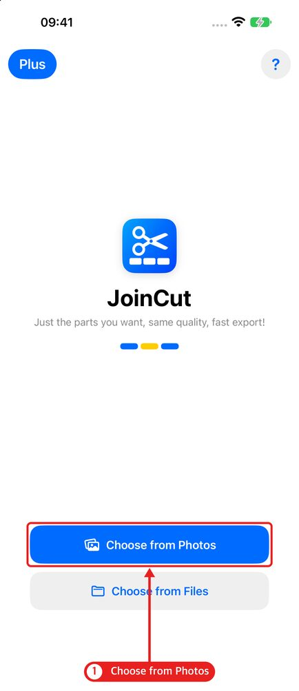
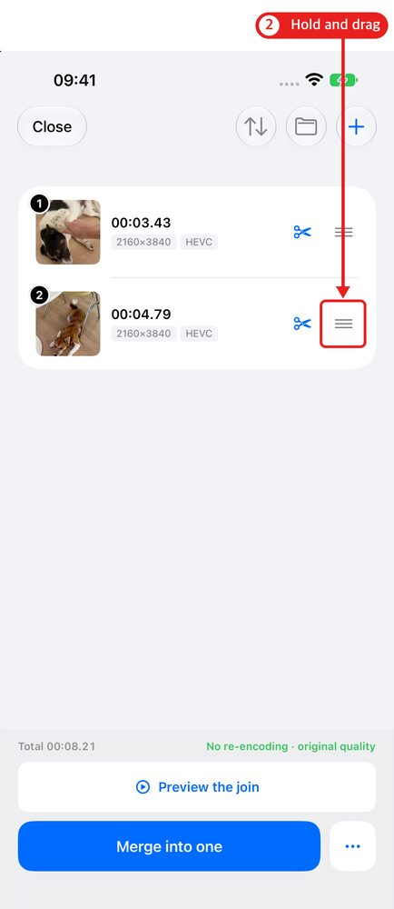
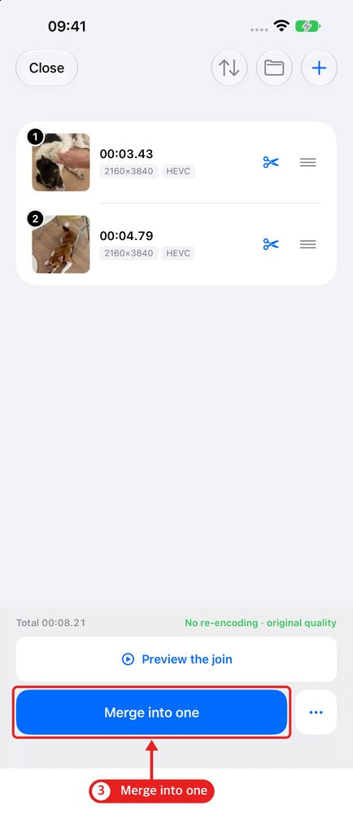
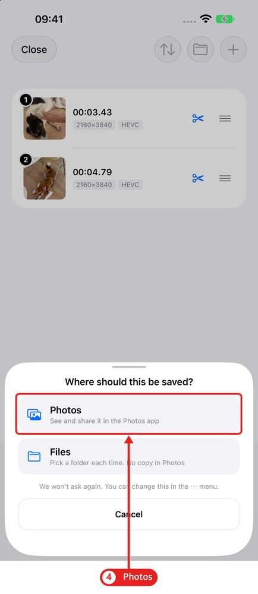
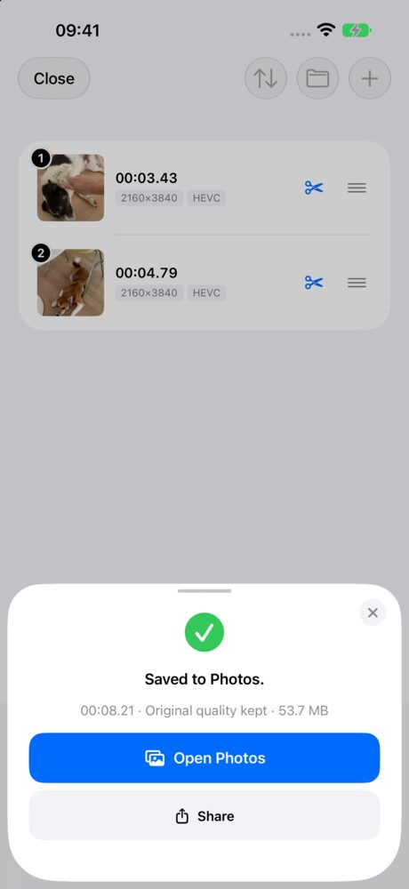
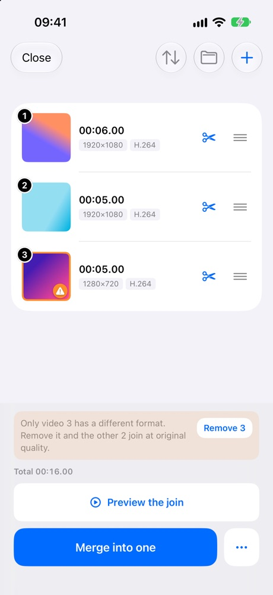
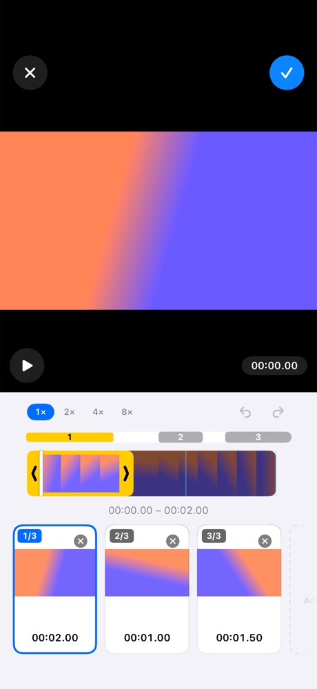

You can join videos on an iPhone without losing any quality. It works when the clips share the same format, and it finishes in seconds instead of minutes, because none of the frames are drawn again.

Here is what goes wrong in most apps, and how to avoid it.

## Can you combine videos on iPhone without an app?

Not in Photos. It can trim a video, but it has no button that joins two clips into one. The usual answer is iMovie, Apple's free editor: start a movie, add the clips, and export. iMovie re-encodes everything when it exports, though, so the result is a new copy of your video, not the original frames.

## Why do merged videos lose quality?

Most editors re-encode. They decode every frame of your clips and write the whole thing out again as a new file. That second pass is where the quality goes: fine detail, grain and fast motion get approximated, and the result is a copy of a copy.

It also costs you time. Re-encoding a few minutes of 4K video can take minutes and drain battery, all to produce something that looks slightly worse than what you started with.

## How do you know a merge re-encoded your video?

Three signs give it away.

- The app asks you to choose a resolution or a quality setting before saving. A lossless join has nothing to choose.
- Saving takes minutes rather than seconds.
- The saved file is much larger or much smaller than the originals added together.

| | Re-encoded join | Lossless join |
|---|---|---|
| The frames | Decoded and drawn again | Copied as they are |
| Quality | A copy of a copy | Same as the original |
| Time to save | Minutes for a few minutes of 4K | Seconds |
| Asks for a quality or resolution | Yes | Nothing to choose |
| Works when | Always | The clips share a format |

## When does lossless merging work?

When the clips match. Video files carry a format, and two files can only be stitched together untouched if they agree on it.

Clips shot on the same iPhone with the same camera setting almost always match. A screen recording next to a camera clip, a video downloaded from the web, or a 4K clip next to a 1080p one usually does not. When the formats differ, something has to be re-encoded. MKV files from a computer can join too, if their tracks are H.264 or HEVC: see [how to play MKV files on iPhone](/blog/open-mkv-files-on-iphone/).

## How to combine videos on iPhone without losing quality

1. Open [JoinCut](/apps/joincut/), tap **Choose from Photos** and pick the videos you want to join. They are numbered in the order you picked them.
2. To change the order, touch and hold a video and drag it up or down. The lines at the right of each row show it can be moved.
3. Check for the green line **No re-encoding · original quality**, then tap **Merge into one**.
4. The first time, JoinCut asks where to save. Tap **Photos**.

<figure><figcaption>1. Choose from Photos</figcaption></figure>
<figure><figcaption>2. Hold a video and drag to reorder</figcaption></figure>

<figure><figcaption>3. Merge into one</figcaption></figure>
<figure><figcaption>4. Save to Photos</figcaption></figure>

<figure><figcaption>Saved to Photos, original quality kept</figcaption></figure>

Formats that match are joined losslessly, and saving takes seconds. Joining two videos and saving them is free, with no ads and no watermark. JoinCut Plus joins three or more videos at once.

If one clip does not match the rest, JoinCut points out which video is forcing the re-encode. You can drop that one with a tap and keep the rest lossless, or let it re-encode if you need that clip in the video.

<figure><figcaption>One clip that does not match: JoinCut names it and offers to drop it</figcaption></figure>

## Keeping only part of a video

The same applies when you do not want the whole clip. Split a video into sections, keep the ones worth keeping, and they are joined back into one video without re-encoding. The trimmer zooms in up to 8x, so a cut lands exactly where you meant it to. For a quick cut at the start or end only, Photos is enough: see [how to trim a video on iPhone](/blog/trim-video-iphone/).

<figure><figcaption>One video split into three parts, joined back without re-encoding</figcaption></figure>

If you only need the sound, you can [extract the audio from a video](/blog/extract-audio-from-video-iphone/) instead.

That is the whole idea: leave the original frames alone, and only stitch.
