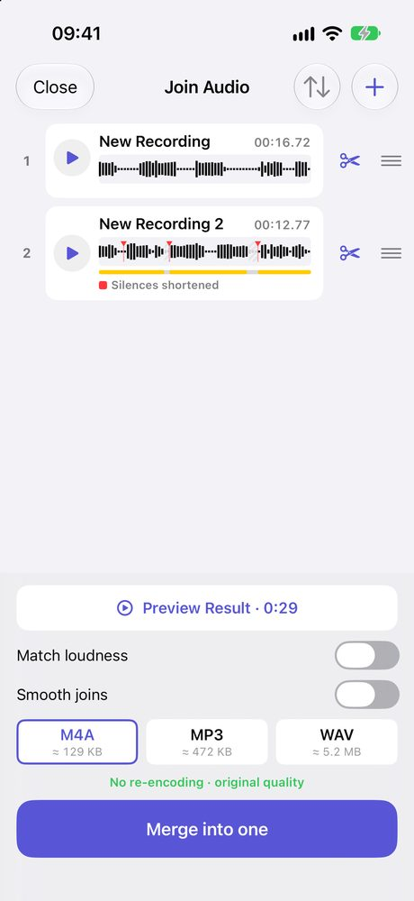
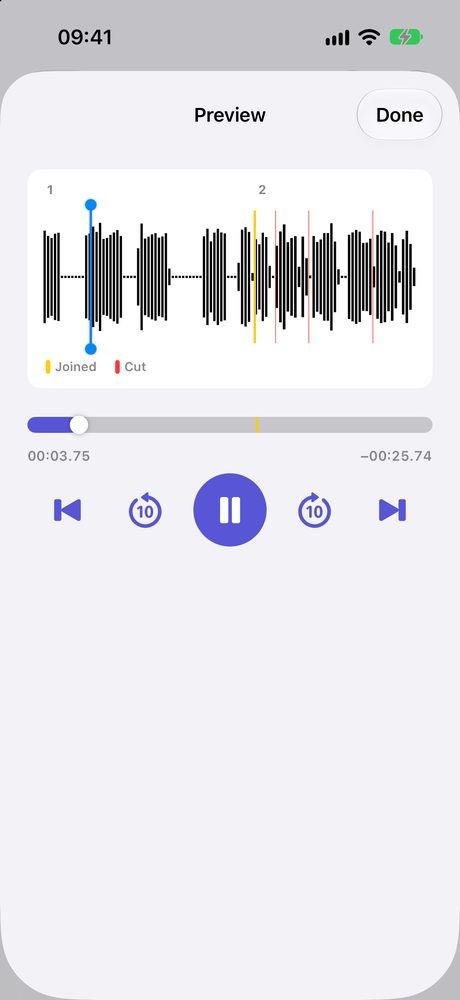

You recorded a lecture, a meeting or a song idea in two or three parts, and now you want one file. Voice Memos can't do that on its own. You need a second app. Here is the shortest way, and what each option costs.

<figure><figcaption>Two voice memos, top to bottom. The red marks on the second are Shorten silences, a Plus option.</figcaption></figure>
<figure><figcaption>Preview: hear the joined file before you save it</figcaption></figure>

## Can you merge voice memos on iPhone without an app?

No. Voice Memos lets you [trim a recording or replace part of it](https://support.apple.com/guide/iphone/edit-or-delete-a-recording-iphc9bdaee83/ios), but there is no button that joins two separate recordings into one.

Your choices are:

| | Voice Memos alone | GarageBand | JoinSound |
|---|---|---|---|
| Join two recordings | ✗ | ✓ | ✓ |
| How | - | Save each memo to Files, import them onto a track, line them up, export | Share the memos, tap Merge into one |
| Free | ✓ | ✓ | ✓ for two recordings |
| Recordings leave your iPhone | No | No | No |

GarageBand is free and works, but it is a music studio. You place each recording on a timeline yourself. If all you want is "this, then this", that is more than you need.

## How to merge voice memos on iPhone

1. In Voice Memos, open a recording and tap the **Share** button. Pick **Add to JoinSound**. If you don't see it, tap **More** at the end of the app row.
2. Do the same for the next recording. Each one is added to the end of the list in JoinSound.
3. In JoinSound, drag the rows into the order you want. Tap the scissors on a row to cut a cough or a false start from the beginning or end.
4. Tap **Preview Result** to hear the whole thing, then tap **Merge into one**.

The new file is named with the date and time. Tap **Share** where the save button was to save it to Files, send it in a message, or open it in another app.

You can also open JoinSound first and pick the recordings with **+**, if they are already saved in Files.

## Does merging lower the quality?

Usually not. Voice memos are M4A files, so when you save as M4A, JoinSound can put them together without re-encoding them. The screen says **No re-encoding · original quality** when it does.

Two switches change that, because they have to rewrite the sound:

| Switch | Use it when |
|---|---|
| Match loudness | One memo was recorded much closer or farther away than the other |
| Smooth joins | You hear a click where one recording ends and the next begins |

## Is it free?

Merging two voice memos is free, with no ads and no sign-in.

| | Free | JoinSound Plus |
|---|---|---|
| Recordings in one file | 2 | 3 or more |
| Trim | ✓ | ✓ |
| Shorten long silences | | ✓ |
| Save as | M4A | M4A, MP3, WAV |

On iPhone, Plus is a 1-year plan or a one-time lifetime purchase.

## Are my recordings uploaded?

No. There is no account, and your recordings are never uploaded. They are read and joined on your iPhone, and the result goes only where you save or share it.

JoinSound also runs on iPad and Android. If you need to put a voice over background music instead of one after another, that is a different job: see [back to back or layered](/blog/combine-audio-files-iphone-back-to-back-or-layered/).
