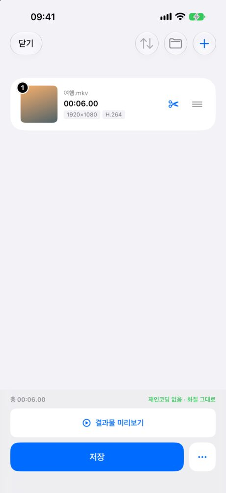
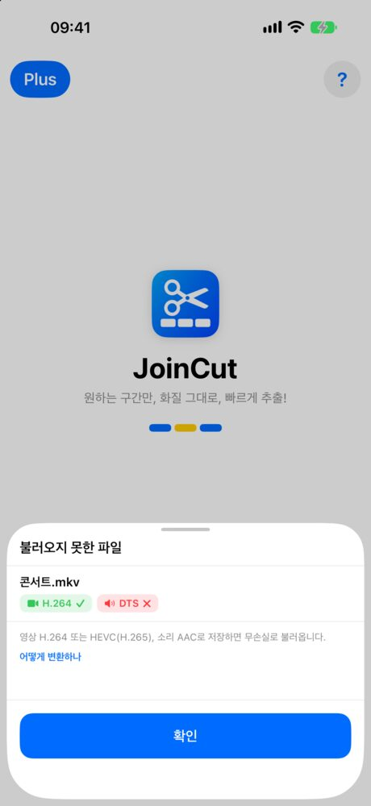

아이폰에서 MKV를 보는 길은 둘입니다. **자막까지 켜서 한 번 볼 거라면 VLC 같은 재생 앱**이 맞고, **사진 앱에 넣어 두고 보거나 보내거나 자를 거라면 MOV로 옮겨 저장**하는 편이 낫습니다.

옮기는 일은 [JoinCut](/ko/apps/joincut/)이 합니다. 영상을 다시 인코딩하지 않아 화질이 그대로입니다. 다만 열 수 있는 파일에 조건이 있습니다.

## 아이폰에서 MKV가 안 열리는 이유

MKV는 영상과 소리를 담는 상자입니다. 안에 든 영상은 MP4와 똑같은 H.264나 HEVC인 경우가 많습니다.

문제는 아이폰의 기본 재생 기능이 이 상자를 읽지 못한다는 점입니다. 화질이나 파일 손상 탓이 아닙니다. 그래서 상자만 바꿔 주면 내용은 손대지 않고 볼 수 있습니다.

## 아이폰 MKV 재생 방법, 사진 앱에 저장하기

<figure><figcaption>열린 MKV. 재인코딩 없이 저장됩니다</figcaption></figure>
<figure><figcaption>소리가 DTS라 열지 못한 경우</figcaption></figure>

1. MKV 파일을 **파일** 앱에 넣어 둡니다.
2. JoinCut에서 파일을 고릅니다. 파일 앱에서 **공유 > JoinCut**으로 열어도 됩니다.
3. **재인코딩 없음 · 화질 그대로**라고 나오면 **저장**을 누릅니다.
4. 처음이면 저장할 곳을 묻습니다. **사진**을 고르면 사진 앱에서 다른 영상처럼 재생됩니다.

앞뒤를 자르거나 필요한 구간만 골라 저장할 수도 있습니다. MKV 하나를 저장하는 것은 무료입니다.

## 열리는 MKV와 안 열리는 MKV

영상과 소리가 둘 다 조건에 맞아야 합니다.

| | 열림 | 안 열림 |
|---|---|---|
| 영상 | H.264, HEVC(H.265) | VP9 등 |
| 소리 | AAC, AC-3, MP3 | DTS 등 |
| 자막 | 저장할 때 빠짐 | - |
| 소리 트랙이 여러 개 | 기본으로 정해진 하나만 저장 | - |

하나라도 벗어나면 JoinCut은 파일을 열지 않습니다. 영상만 가져오면 소리 없는 영상이 되기 때문입니다. 대신 어느 쪽이 문제인지 보여 줍니다.

소리만 문제라면 PC 변환 프로그램에서 영상은 복사로 두고 소리만 AAC로 바꾸면 됩니다. 영상을 다시 인코딩하지 않으니 화질이 그대로입니다.

## 자막이 있는 MKV라면

JoinCut은 자막을 옮기지 않습니다. 영화나 드라마처럼 자막이나 음성을 골라 봐야 하는 파일은 VLC처럼 MKV를 바로 재생하는 앱이 맞습니다.

## 아이폰에서 MKV를 MP4로 변환해야 할까

사진 앱에서 보거나 다른 사람에게 보내는 것이 목적이라면 MP4가 아니어도 됩니다. JoinCut은 아이폰 카메라가 쓰는 것과 같은 MOV로 저장합니다.

MP4만 받는 사이트에 올려야 한다면 변환 앱이나 프로그램이 따로 필요합니다. 이때도 재인코딩 없이 상자만 바꾸는 기능이 있는지 먼저 봅니다.

## MKV 합치기도 되나

됩니다. MKV 두 개, 또는 MKV와 MOV를 골라 하나로 이어 붙입니다. 해상도나 코덱 같은 형식이 같으면 재인코딩 없이 합쳐지고, 다르면 다시 인코딩합니다. 두 개까지 무료이고, 세 개부터는 JoinCut Plus가 필요합니다. Plus는 1주·1년 구독이나 평생 이용권입니다.

AVI는 열지 않습니다. 자세한 사용법은 [JoinCut 사용법](/ko/apps/joincut/how-to/)에 있습니다.

## 갤럭시에서는

JoinCut 안드로이드판도 같은 조건으로 MKV를 엽니다. 다만 소리가 AC-3나 MP3면 저장할 때 소리를 다시 인코딩합니다. 영상은 그대로입니다.
