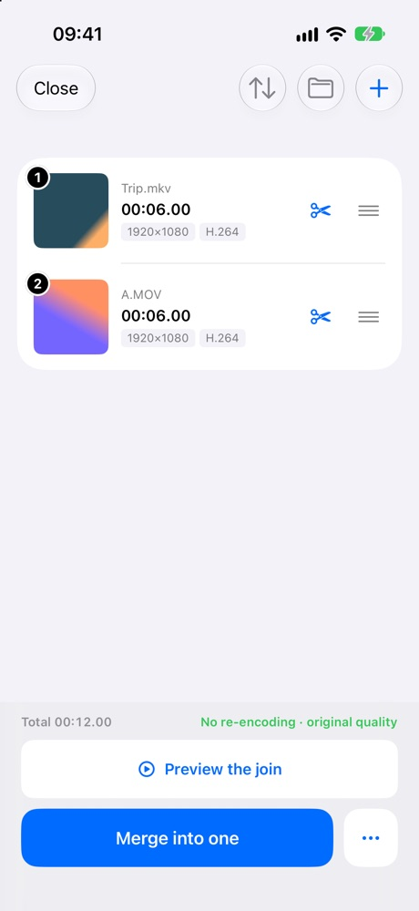
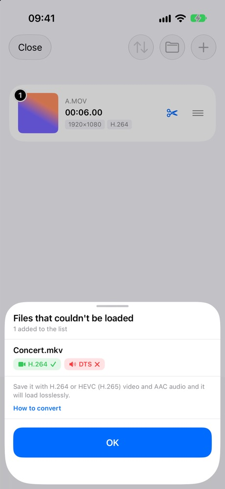

An iPhone will not open an MKV file. Tap one in the Files app and most apps simply refuse it.

JoinCut opens them as of this version, and nothing is re-encoded. There is a condition, and this post is mostly about being straight about that condition.

## Where this came from

A user wrote in with a simple request: let the app read video files from Files that are not MP4 or MOV, MKV and AVI for example.

It was a good request, so it went into this release. One of the two formats made it. The other did not, and the reason is worth explaining.

## Why can't an iPhone open MKV files?

MKV is a container. It is a box that holds a video track and an audio track, the same way MP4 is a box. The picture inside is very often the exact same H.264 or HEVC video an MP4 would hold.

The problem is that iOS media playback does not read that box at all. It is not a quality issue or a codec issue. The system simply does not know the format, so the file is refused before anything inside it is looked at.

That is also why "converting" an MKV usually means re-encoding the whole video, which costs quality and time for a file that was already fine.

## What JoinCut does with an MKV

It reads the box itself, takes the compressed video and audio out, and puts them into a container iOS does understand. The frames are never decoded and never drawn again. They are copied over as they are.

So the file opens at original quality, and from there it behaves like any other video in the app: trim it, pick the parts you want, and join it with other clips. Saving stays lossless as long as the clips share a format, which is [the rule from the earlier post](/blog/merge-videos-iphone-without-losing-quality/).

## Which MKV files will open

The video has to be H.264 or HEVC, and the audio has to be AAC, AC-3 or MP3.

| Track | Opens | Does not open |
|---|---|---|
| Video | H.264, HEVC | VP9 and others |
| Audio | AAC, AC-3, MP3 | DTS and others |

If either side falls outside that, JoinCut does not open the file at all. That is deliberate. Importing the video and throwing the audio away would be the easy path, and it would hand you a silent video without saying so. Lossless is the whole point of the app, so a half lossless import is not on the menu.

The usual blockers are DTS audio and VP9 video.

## If a file does not open, the app says what to change

Rather than a generic failure, JoinCut tells you why that specific file was refused and what to do about it: save it with H.264 or HEVC video and AAC audio and it will load losslessly.

And if it is only the audio that is wrong, you do not have to touch the picture. Set the video to copy and convert only the audio to AAC. The video stays exactly as it was, and the file opens.

<figure><figcaption>An H.264 MKV opens and joins with a MOV at original quality</figcaption></figure>
<figure><figcaption>DTS audio: the app shows which track is the problem</figcaption></figure>

## What about AVI?

AVI is not opened, on purpose, even in cases where the device could read it.

The line JoinCut draws is not "what can we display" but "what can we keep at original quality from start to finish". AVI sits outside that line, so it is refused up front instead of quietly producing a re-encoded result.

## On Android too, with one difference

The Android version got MKV in the same release, by the same codec rule.

The difference is at the other end. On Android, AC-3 or MP3 audio is re-encoded when you save, because the Android muxer cannot carry those tracks over. On iPhone they pass through untouched.

| Audio in the MKV | iPhone | Android |
|---|---|---|
| AAC | Copied as is | Copied as is |
| AC-3, MP3 | Copied as is | Re-encoded when you save |

If you have a folder of MKV clips you have been unable to touch on your phone, pick them in the Files app and see if they open. From there you can merge several MKV files into one, and if a file does not open, the app tells you exactly which piece to change.
