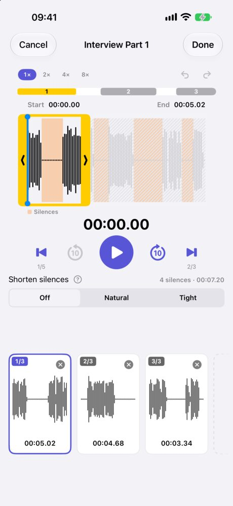
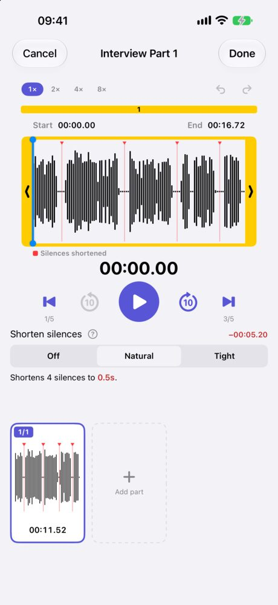

To remove silence from audio on a phone, open the recording in an app that finds the quiet gaps and shortens them for you. In JoinSound, that is one tap: **Shorten silences**, then **Natural** or **Tight**. It works the same on iPhone and Android, and the short pauses between words stay, so the voice doesn't sound chopped.

<figure><figcaption>Off: the silences are marked in orange, with how many and how long</figcaption></figure>
<figure><figcaption>Natural: each long silence becomes half a second</figcaption></figure>

## Remove silence or shorten it?

Shorten it. If every quiet moment is cut out, words run into each other and the recording sounds rushed. What you usually want gone is the dead air: the five seconds while someone thinks, or the gap before the speaker starts.

So JoinSound leaves any pause shorter than half a second alone, because that is a breath. Longer silences are cut down, not cut out:

| Setting | A long silence becomes | Good for |
|---|---|---|
| Off | Unchanged, but shown in orange | Seeing where the gaps are first |
| Natural | 0.5 seconds | Interviews, lectures, voice notes |
| Tight | 0.2 seconds | Fast-paced clips, or when every second counts |

What counts as silence is measured for each recording, so a quiet room and a noisy café both work.

## How to shorten silences in a recording

1. Open JoinSound and tap **Choose Audio Files**. Pick your recording from Files, or share it to JoinSound.
2. Tap the scissors on the recording's row.
3. Look at the orange marks and the count under the waveform. That is every long silence in the file.
4. Under **Shorten silences**, tap **Natural** or **Tight**. The change happens right away, and the time saved shows in red.
5. Play it back. If it sounds too tight, tap **Natural**. If you change your mind, tap **Off**.
6. Tap **Done**, then save as M4A, MP3 or WAV.

Have several recordings? Each file gets its own setting, so a music intro can stay as it is while the interview after it is tightened. JoinSound then joins them into one file, the same way it [combines voice memos](/blog/merge-voice-memos-iphone/).

## Is it free?

Seeing the silences is free. Shortening them takes JoinSound Plus.

| | Free | JoinSound Plus |
|---|---|---|
| See where the silences are, and how long | ✓ | ✓ |
| Trim the start and end by hand | ✓ | ✓ |
| Shorten all silences in one tap | | ✓ |
| Save as | M4A | M4A, MP3, WAV |

On the free version you can still cut a gap by hand: the orange marks show where it is, and each file can be split into two parts. For a recording with many pauses, the one-tap setting is much quicker.

## Other ways to remove silence from audio

- **Audacity on a computer.** Its Truncate Silence effect does the same job for free. It needs a computer, and you set the threshold and length yourself.
- **Video editors such as CapCut or Premiere Pro.** Worth it if the audio is part of a video you are already editing.
- **Online tools.** Nothing to install, but the recording is uploaded to someone else's server. Skip them for private calls or interviews.

## Does it change my original recording?

No. JoinSound saves a new file, and the recording you picked stays as it was. There is no account, and nothing is uploaded.

If the recording was made of several pieces, see [how to merge audio files into one](/blog/combine-audio-files-iphone-back-to-back-or-layered/), where silences, loudness and joins are covered together.
