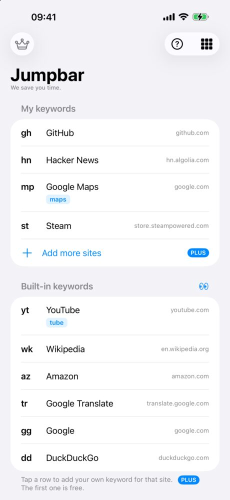
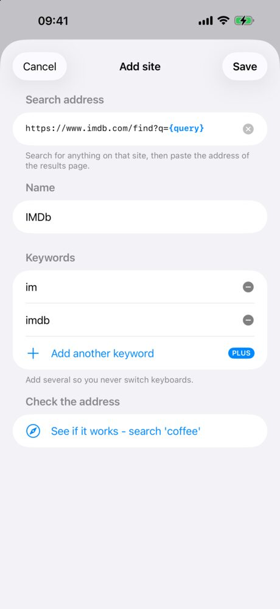

Safari on iPhone has no button for adding your own search engine. You can only pick one from Apple's list. What you can do is search any other site straight from the address bar with a short keyword, the way site search shortcuts work in Chrome on a computer. Here is how.

<figure><figcaption>Each site gets a short keyword. Type it before your search in the address bar.</figcaption></figure>
<figure><figcaption>Adding a site: paste its search address, name it, pick a keyword</figcaption></figure>

## Can you add a custom search engine to Safari on iPhone?

No. In **Settings > Apps > Safari > Search Engine** you can choose only from the engines Apple lists, such as Google, Bing, DuckDuckGo and Ecosia. There is no field for your own address.

There are two ways around it:

| | Quick Website Search (built in) | Jumpbar (Safari extension) |
|---|---|---|
| What you type | `amazon coffee`, then tap **Search amazon.com for "coffee"** | `az coffee`, and you land on results |
| Which sites | Only sites Safari has learned from you using their own search box | Any site whose search results have an address |
| You choose the keyword | ✗ | ✓ |
| Works with your default engine | ✓ | ✓ Google, Bing, DuckDuckGo, Ecosia, Yahoo and more |
| Cost | Free | Free for the built-in keywords and one site of your own |

Quick Website Search is already on your iPhone, under **Settings > Apps > Safari**. It is worth a try first. Its limit is that you don't decide which sites it knows, or what you type to reach them.

## How to search a site from the Safari address bar

1. Install [Jumpbar](/apps/jumpbar/) and open it once.
2. Go to **Settings > Apps > Safari > Extensions**, tap **Jumpbar**, and turn on **Allow Extension**.
3. Under Permissions, set **All Websites** to **Allow**. With the default, Ask, the extension never runs.
4. Back in Safari settings, turn off **Preload Top Hit**. Leaving it on makes the jump miss sometimes.
5. In Safari, type a keyword, a space and your search: `yt lofi`, `wk coffee`, `az usb c cable`.

Safari sends the search to your default engine as usual. Jumpbar sees the keyword at the start and switches to that site's results before the page loads. A search without a keyword goes to your default engine as it always did.

Type just the keyword, like `yt`, to open the site's home page.

## How to add any site as a search engine

1. On the site, search for anything, for example `coffee`.
2. Copy the address of the results page. It looks like `https://www.imdb.com/find?q=coffee`.
3. In Jumpbar, tap **Add a site** under My keywords and paste it. The app finds your search word and replaces it with `{query}`.
4. Give it a name and a keyword, then tap **See if it works** to try it.

If you'd rather not look up addresses, the [keyword gallery](/apps/jumpbar/gallery/) has ready-made sites you can add with one tap. Each address there was checked against the live site.

## Can I change the keyword for YouTube or Google?

The built-in keywords stay, but you can add your own next to them. Type `y` instead of `yt`, if that suits your fingers. The first extra keyword is free.

## Does it see what I search?

The extension only does anything on search engine result pages. On every other page it checks the address and stops. Your search words are compared inside Safari and never leave your iPhone. There is no account and no analytics.

## Is it free?

| | Free | Jumpbar Plus (one-time purchase) |
|---|---|---|
| Built-in keywords (YouTube, Wikipedia, Amazon and more) | ✓ | ✓ |
| Sites you add yourself | 1 | No limit |
| Extra keywords | 1 | No limit |
| iCloud sync between iPhone and iPad | | ✓ |

Jumpbar also runs on iPad. It does not run on a Mac.
