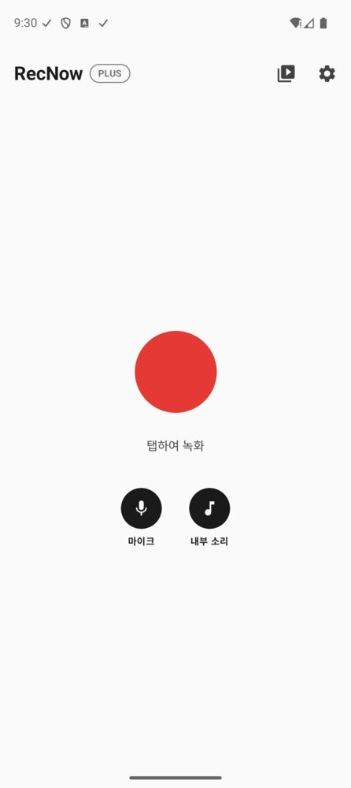
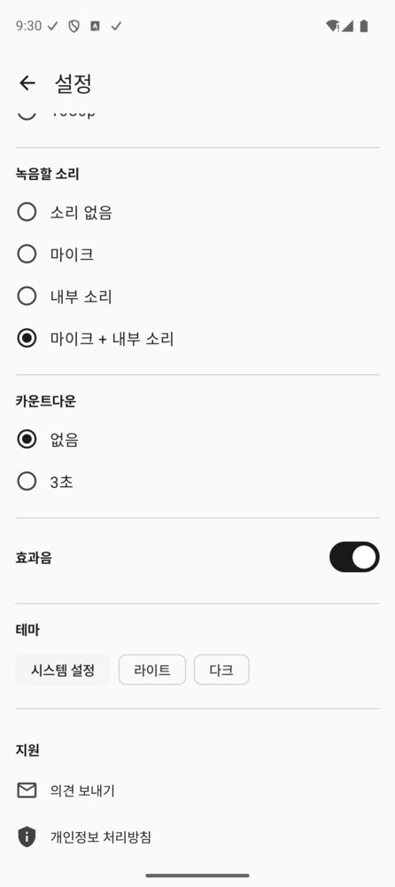

갤럭시 화면녹화는 **빠른 설정창 > 화면 녹화**로 시작합니다. 소리는 녹화를 시작하기 전에 골라야 합니다. 소리 없이 녹화한 영상에 나중에 소리를 되살릴 수는 없습니다.

버튼이 아예 없는 기종이라면 화면 녹화 앱을 쓰면 됩니다.

## 갤럭시 화면녹화 방법

1. 화면 오른쪽 위를 아래로 쓸어내려 빠른 설정창을 엽니다.
2. **화면 녹화**를 누릅니다. 안 보이면 빠른 설정창을 펼치고, 그래도 없으면 버튼 편집에서 추가합니다.
3. 소리를 고르고 **녹화 시작**을 누릅니다. 3초를 센 뒤 녹화됩니다.
4. 끝내려면 화면 위쪽 도구 막대에서 정지를 누릅니다.

## 갤럭시 화면녹화 소리 설정

녹화를 시작하는 창의 **소리 설정** 또는 **녹음할 오디오**에서 고릅니다.

| 고르는 것 | 담기는 소리 | 이럴 때 |
|---|---|---|
| 소리 없음 | 없음 | 화면만 필요할 때 |
| 미디어 소리 | 게임, 음악, 영상 소리 | 내 목소리를 빼고 싶을 때 |
| 미디어 소리 및 마이크 | 미디어 소리와 내 목소리 | 설명하면서 녹화할 때 |

One UI 버전에 따라 메뉴 이름이나 고르는 방식이 다를 수 있습니다.

## 갤럭시 화면녹화 소리 안 남, 확인할 것

- **소리 없음으로 녹화했는지.** 가장 먼저 볼 곳입니다. 녹화를 다시 시작하면서 소리를 확인합니다.
- **앱이 막아 둔 것인지.** 저작권 보호가 걸린 앱이나 영상은 녹화가 제한될 수 있습니다. 앱이 소리 녹음을 막으면 화면만 남기도 합니다. 폰이 고장 난 것이 아니고, 다른 녹화 앱으로 바꿔도 풀리지 않습니다.
- **통화 중이었는지.** 통화나 영상통화 소리는 기종과 앱에 따라 담기지 않을 수 있습니다. 꼭 필요한 회의라면 회의 앱의 녹화 기능을 쓰고, 참석자에게 먼저 동의를 구합니다.

다시 찍기 어려운 장면이라면 10초만 시험 녹화해 소리부터 들어 봅니다.

## 갤럭시 화면녹화 없음, 버튼이 안 보일 때

버튼 편집에도 없다면 그 모델에 화면 녹화가 없을 수 있습니다. 삼성전자서비스는 모델에 따라 지원하지 않을 수 있고, 그럴 때는 화면 녹화 앱을 설치하라고 안내합니다.

저희가 만든 [RecNow](/ko/apps/recnow/)는 안드로이드 10 이상에서 쓰는 화면 녹화 앱입니다. 5MB 미만이고 광고와 워터마크가 없습니다.

<figure><figcaption>마이크와 내부 소리를 둘 다 켠 상태</figcaption></figure>
<figure><figcaption>설정에서도 고를 수 있습니다</figcaption></figure>

1. 처음에는 소리가 꺼져 있습니다. **내부 소리**나 **마이크**를 누릅니다. 둘 다 켜도 됩니다.
2. 마이크 권한을 허용합니다. 내부 소리만 녹음할 때도 안드로이드가 이 권한을 요구합니다.
3. 빨간 버튼을 누르고 안드로이드 확인 창에서 시작을 누릅니다. 여러 앱을 오가며 찍는다면 전체 화면을 고릅니다.
4. 정지를 누르면 녹화 목록에 저장됩니다. 거기서 재생하고 공유합니다.

RecNow도 앱이 막아 둔 소리와 통화 상대의 목소리는 녹음하지 못합니다.

모든 기능이 무료이고 한 번에 10분까지 녹화합니다. 더 길게 녹화하려면 RecNow Plus를 한 번만 결제하면 되고, 구독은 아닙니다. 녹화한 영상은 폰에만 저장됩니다.

## 갤럭시 화면녹화 저장 위치와 최대 시간

- **저장 위치:** 갤러리의 화면 녹화 폴더에 있습니다. 파일로는 **내장 저장 공간 > DCIM > Screen recordings**입니다.
- **최대 시간:** 안드로이드 11(One UI 3.0)부터 정해진 제한이 없습니다. 안드로이드 10(One UI 2.5)은 1시간 또는 4GB까지입니다. 저장 공간이 부족하면 더 짧아질 수 있습니다.
- **RecNow로 녹화한 영상:** **Movies > RecNow** 폴더에 저장됩니다.

녹화한 영상의 앞뒤를 잘라 내려면 [JoinCut](/ko/apps/joincut/)을 쓸 수 있습니다.

<small>참고: 삼성전자서비스 [화면 녹화 안내](https://www.samsungsvc.co.kr/solution/25203) (2026년 10월 1일 기준)</small>
