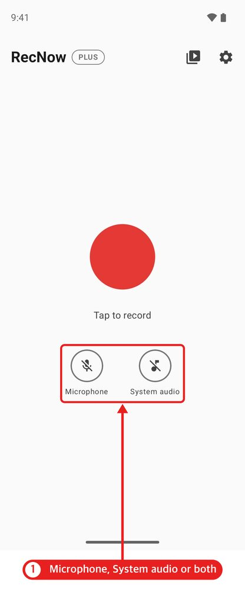
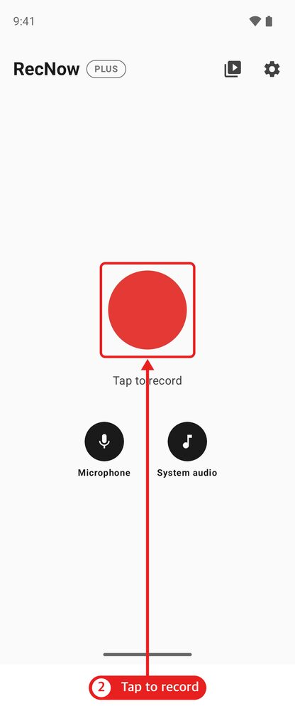
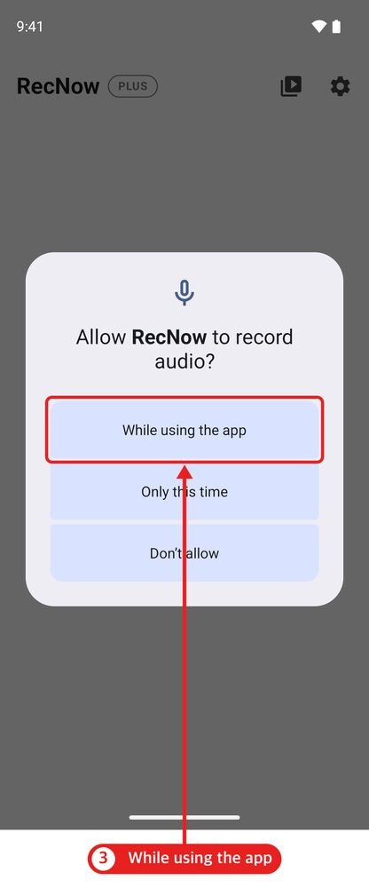
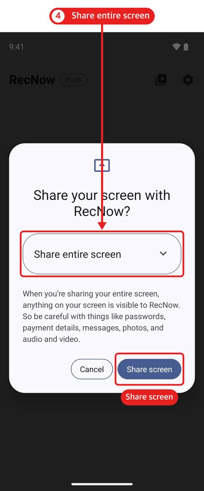
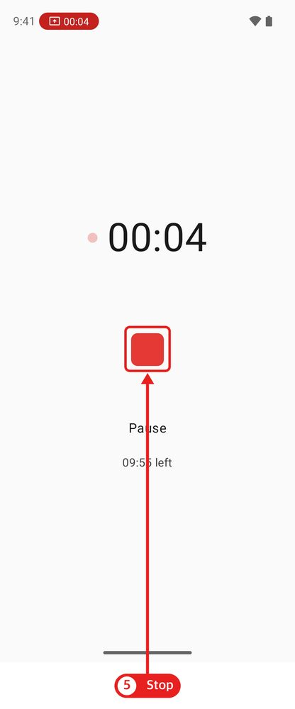
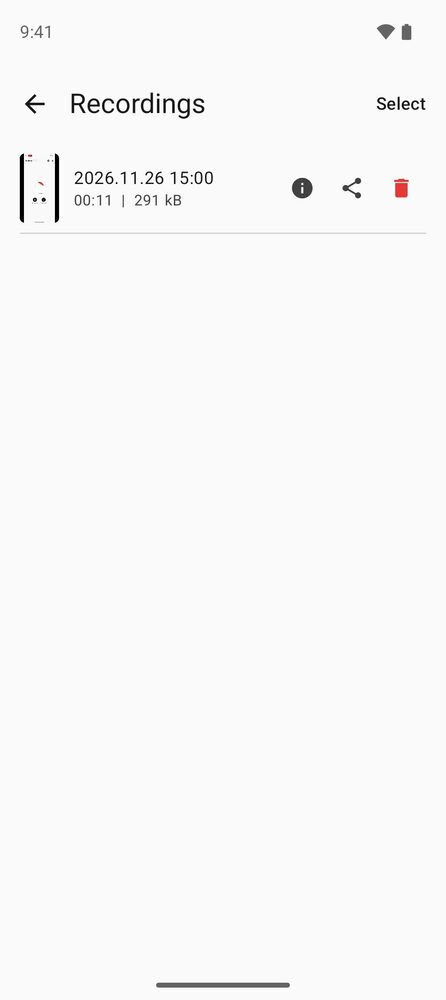

To screen record with sound on Android, choose the sound before you press start: device audio for what the phone plays, the microphone for your voice, or both. A recording made without it stays silent, and the sound can't be added back later.

Most phones with Android 11 or later have a recorder in Quick Settings. If yours doesn't, an app such as RecNow does the same job.

## With the built-in screen recorder

1. Swipe down from the top of the screen twice to open Quick Settings.
2. Tap **Screen record** or **Screen recorder**. If it isn't there, tap the edit button and add it.
3. Choose the sound. The names depend on the phone:

| You want to record | Pixel | Samsung Galaxy |
|---|---|---|
| Music, games and videos on the phone | Record device audio | Media, or Media sounds |
| Your voice | Record microphone | - |
| Both | Turn on both | Media and mic, or Media sounds and mic |
| No sound | Leave both off | None, or No sound |

4. Start the recording. To stop, swipe down and tap the recording notification, or use the stop button on the screen.

Wording changes between Android versions, so yours may look a little different.

## With RecNow, if your phone has no recorder

Some phones ship without a screen recorder. We make [RecNow](/apps/recnow/) for Android 10 and later. It is under 5 MB, with no ads and no watermark.

1. Open RecNow. Sound is off at first, so tap **System audio**, **Microphone**, or both. You can also pick **Mic + System** under **Audio source** in Settings.
2. Tap the red button (**Tap to record**).
3. Android asks to let RecNow record audio. Tap **While using the app**. It asks even when you record system audio only.
4. In Android's own dialog, choose **Share entire screen** to record more than one app, then tap **Share screen**. Older Android versions show **Start now** instead.
5. Tap the red square to stop. The video is in **Recordings** (the button next to Settings at the top), ready to play or share.

<figure><figcaption>1. Microphone, System audio or both</figcaption></figure>
<figure><figcaption>2. Tap to record</figcaption></figure>

<figure><figcaption>3. While using the app</figcaption></figure>
<figure><figcaption>4. Share entire screen, then Share screen</figcaption></figure>

<figure><figcaption>5. Stop</figcaption></figure>
<figure><figcaption>The recording, ready to play or share</figcaption></figure>

Want to start without opening the app? Add the RecNow tile to Quick Settings.

## Why does my screen recording have no sound?

Check these in order:

- **Sound was off.** This is the first thing to check. RecNow starts with no audio until you choose it, and so can a built-in recorder.
- **Microphone permission was denied.** RecNow then records the picture only. Allow the microphone in the app's permission settings and record again.
- **The app blocks recording.** Android lets an app keep its sound from being captured by recording apps. The picture may be recorded while the sound is missing, and another recording app won't get around it.
- **Only the microphone was on.** With headphones in, it can't hear what the phone plays. Turn on device audio or system audio as well.
- **It was a call.** See below.

Make a ten-second test before anything you can't record twice.

## Can I screen record a call with sound?

Don't count on it. Android gives recording apps access to media and game sound, not call sound, so RecNow doesn't capture the other person in a phone or video call. Samsung says its own recorder doesn't record phone calls, VoIP calls or video calls either.

If you need a meeting on record, use the recording button in the meeting app, and ask everyone first.

## Can I screen record with sound on Android 9?

Recording sound from other apps came with Android 10. RecNow needs Android 10 or later for that reason. On older phones, the usual workaround is to play the sound through the speaker and record it with the microphone.

## Is RecNow free?

| | Free | RecNow Plus |
|---|---|---|
| System audio, microphone, or both | ✓ | ✓ |
| 720p and 1080p, where your phone supports it | ✓ | ✓ |
| Pause and resume | ✓ | ✓ |
| Number of recordings | Unlimited | Unlimited |
| Length of each recording | 10 minutes | Unlimited |

Plus is a one-time purchase, not a subscription. Recordings stay on your phone and are never uploaded.

To cut off the start and end of a recording afterwards, use [JoinCut](/apps/joincut/) on Android. Our guide to [trimming a video](/blog/trim-video-iphone/) shows the iPhone version. If you only need the sound, JoinSound can [take it out of the video](/blog/extract-audio-from-video-iphone/); it runs on Android too.
