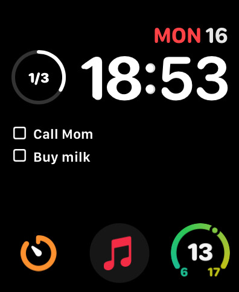
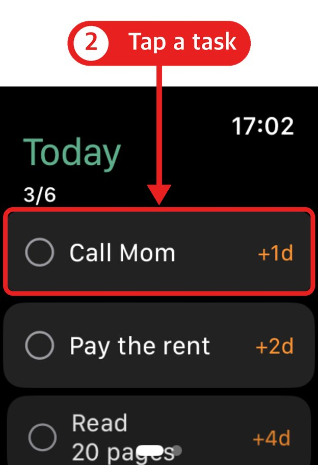
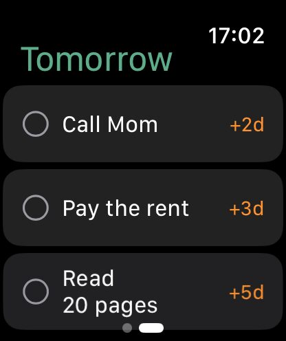

To put a to-do list on your Apple Watch face, add a to-do app's complication to a face with a large slot, like Modular. Today's tasks then sit next to the time, and you see them every time you raise your wrist, without opening an app.

<figure><figcaption>On the watch face: a progress ring and what's left</figcaption></figure>

## How to add a to-do list complication to your watch face

We make [Ivy To Do](/apps/ivy-todo/), a daily to-do list for iPhone with an Apple Watch app. Its complication comes in two shapes:

| Slot on the watch face | What Ivy To Do shows |
|---|---|
| Large rectangle | The tasks still left today |
| Small circle | A ring of tasks done, like 1/3 |
| Corner or one line of text | ✗ not available |

The easiest way is from your iPhone:

1. Open the **Watch** app on your iPhone and tap your face under **My Faces**.
2. Under **Complications**, tap a large slot or a small round one.
3. Choose **Ivy To Do**. The watch face changes right away.

Or on the watch: touch and hold the watch face, tap **Edit**, swipe to the complications, tap a slot, choose **Ivy To Do**, then press the Digital Crown.

## Ivy To Do is not in the list?

Your watch face probably has only corner slots or a single line of text, and Ivy To Do does not fit those. Pick a face with a large rectangle, like **Modular** or **Infograph Modular**, from the **Face Gallery** tab in the Watch app.

## Without changing your watch face

Turn the Digital Crown on the watch face, and the Smart Stack slides up with the same list. Use it if you would rather keep the face you have.

## Check off tasks on your watch

1. Open Ivy To Do on the watch. The **Today** page lists what's left.
2. Tap a task to check it off. The ring and the list on your watch face update with it.

Swipe left to see **Tomorrow**. You add and reorder tasks on your iPhone.

<figure><figcaption>2. Tap a task on the Today page</figcaption></figure>
<figure><figcaption>Swipe left: Tomorrow</figcaption></figure>

Anything you don't finish moves to tomorrow on its own, with a badge like **+2d** that shows how long it has waited. That carry-over comes from [the Ivy Lee Method](/blog/ivy-lee-method-six-tasks-a-day/), a hundred-year-old way to plan six tasks a day.

## Is it free?

Tasks, reminders, history and Home Screen widgets are free, with no ads and no account. The Apple Watch app and its complications are part of Ivy To Do Plus, a one-time purchase that also adds Lock Screen widgets, iCloud sync and a choice of app icons. Family Sharing is included. Without Plus, the complication shows a "Tap to see Plus" note instead of your tasks.

The watch app needs watchOS 10 or later.
