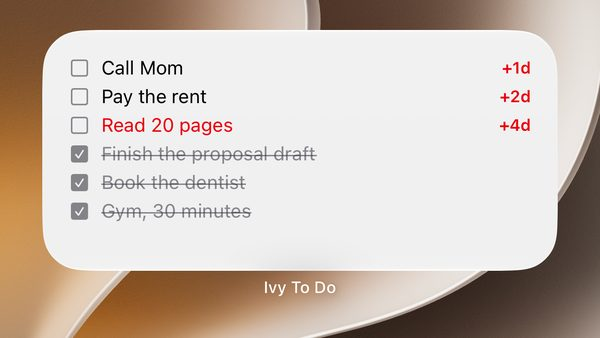
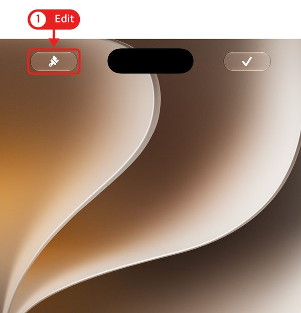
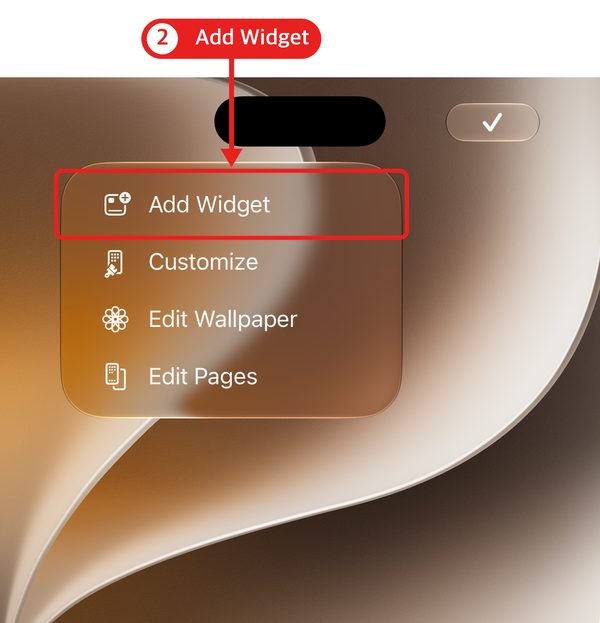
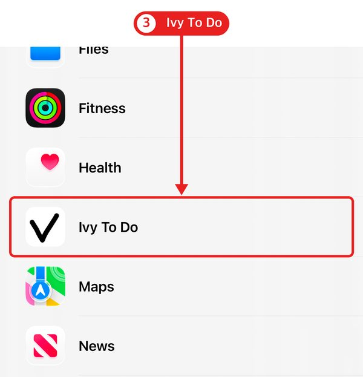
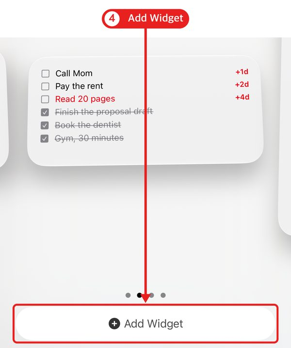
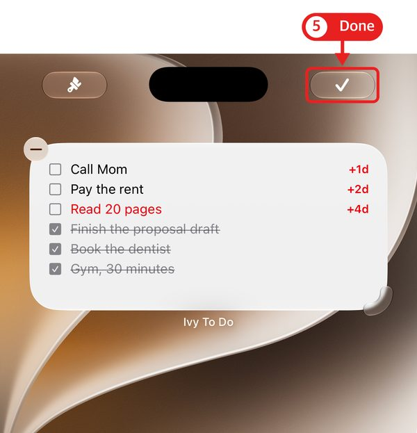
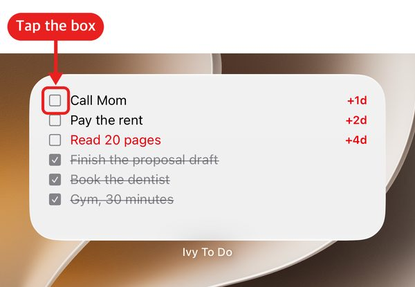
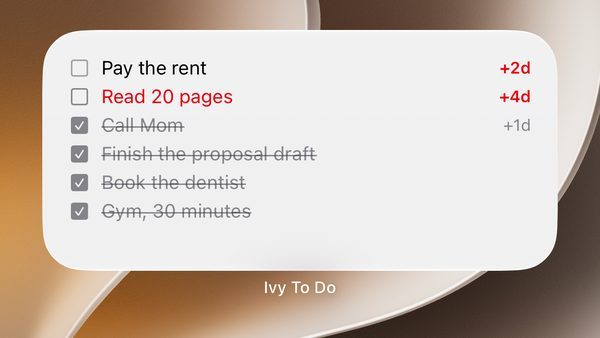
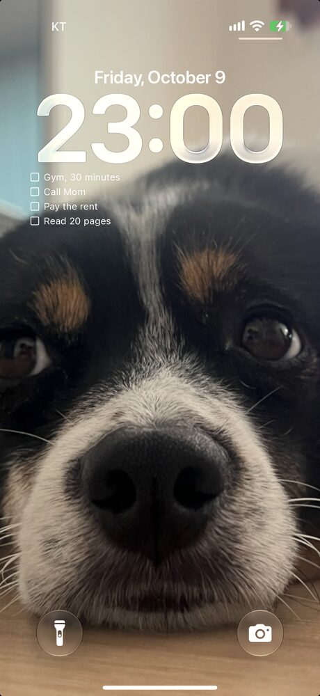

To add a to-do list widget on iPhone, touch and hold an empty spot on your Home Screen, tap **Edit**, then **Add Widget**, and pick your to-do app. Today's tasks then sit on your Home Screen, and on iOS 17 or later you can check them off right on the widget.

<figure><figcaption>A to-do list widget on the Home Screen</figcaption></figure>

## How to add a to-do list widget on iPhone

We make [Ivy To Do](/apps/ivy-todo/), a daily to-do list for iPhone. Its widget is free. Install the app and add a task or two first, so the widget has something to show.

1. Touch and hold an empty spot on your Home Screen until the apps jiggle. Tap **Edit** at the top left (a brush button on iOS 27).
2. Tap **Add Widget**.
3. Scroll the list and tap **Ivy To Do**.
4. Swipe left or right to pick a size, then tap **Add Widget**.
5. Drag the widget where you want it and tap **Done** at the top right (a check mark on iOS 27).

<figure><figcaption>1. Touch and hold, then tap Edit</figcaption></figure>
<figure><figcaption>2. Tap Add Widget</figcaption></figure>

<figure><figcaption>3. Tap Ivy To Do</figcaption></figure>
<figure><figcaption>4. Pick a size, tap Add Widget</figcaption></figure>

<figure><figcaption>5. Tap Done</figcaption></figure>

## Which size should I pick?

| Size | What it shows |
|---|---|
| Small | Up to 6 tasks in a narrow column |
| Medium | Up to 6 tasks, wide enough for longer names |
| Large | Today's date, a count like 3/6, and more tasks in bigger text |
| Extra large (iOS 27) | The large layout, twice as tall |

Medium fits six tasks, which is the number [the Ivy Lee Method](/blog/ivy-lee-method-six-tasks-a-day/) asks you to plan for a day. If you have more, the widget ends with a "+N more" line.

## Check off tasks right on the widget

Tap the box next to a task. It gets a check mark and moves below the tasks still open, so what's left is always on top. Tap the task name instead to open the app on Today.

<figure><figcaption>Tap the box next to a task</figcaption></figure>
<figure><figcaption>Done tasks move down</figcaption></figure>

The red **+2d** badge means a task has waited two days. Ivy To Do moves anything you don't finish to tomorrow on its own, so the widget never shows yesterday's leftovers as a separate list.

## Can I put my to-do list on the Lock Screen?

Yes. Customize your Lock Screen and add Ivy To Do to the widget row under the clock. It shows what's left as a short list, or as a ring like 2/6.

<figure><figcaption>The Lock Screen widget (Plus)</figcaption></figure>

Lock Screen widgets are part of Ivy To Do Plus. The same list can also go [on your Apple Watch face](/blog/to-do-list-apple-watch-complication/).

## Is the to-do list widget free?

Yes. Home Screen widgets in every size are free, along with tasks, reminders and history, with no ads and no account. Ivy To Do Plus is a one-time purchase that adds Lock Screen widgets, iCloud sync, the Apple Watch app and a choice of app icons. Without Plus, a Lock Screen widget shows a "Tap to see Plus" note instead of your tasks.
