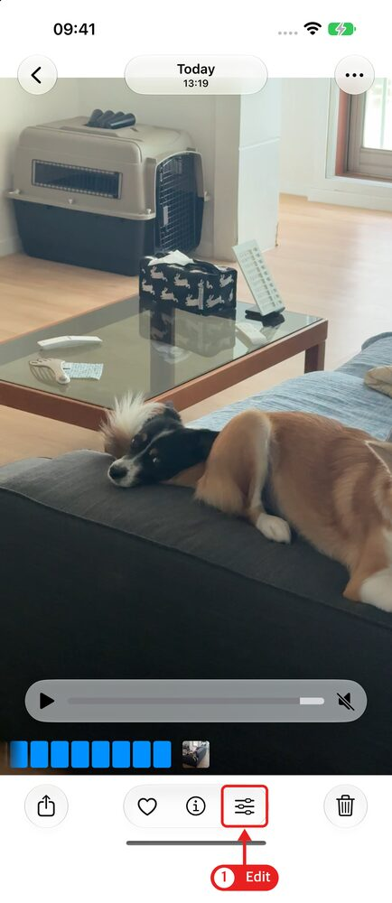
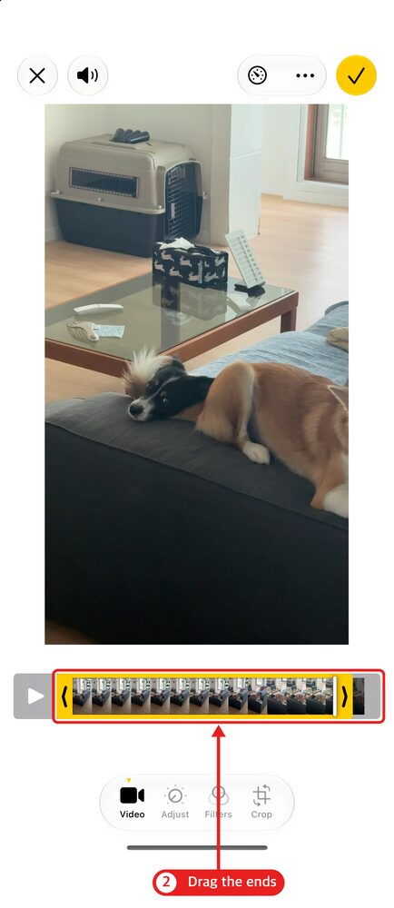
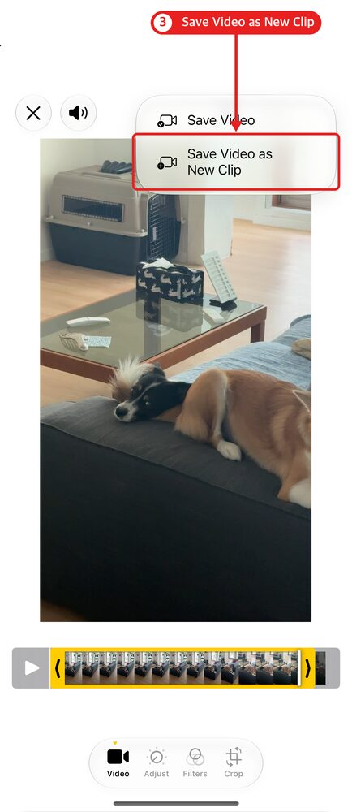
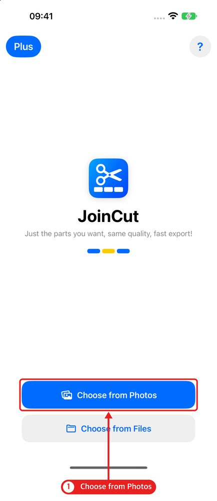
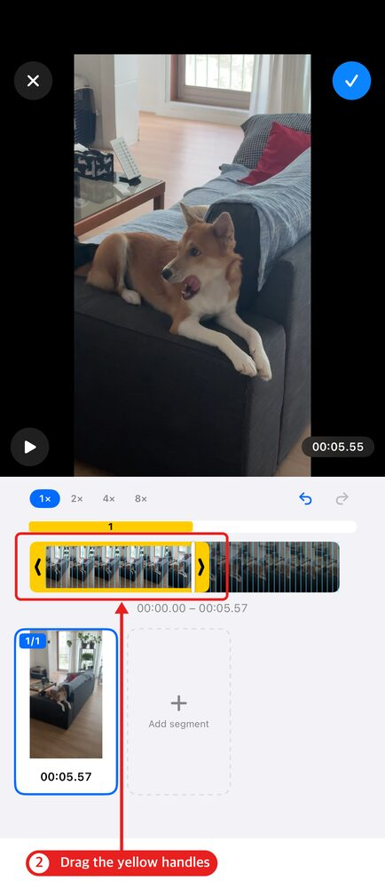
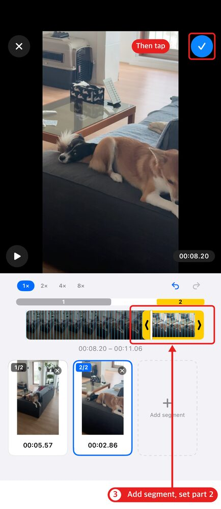
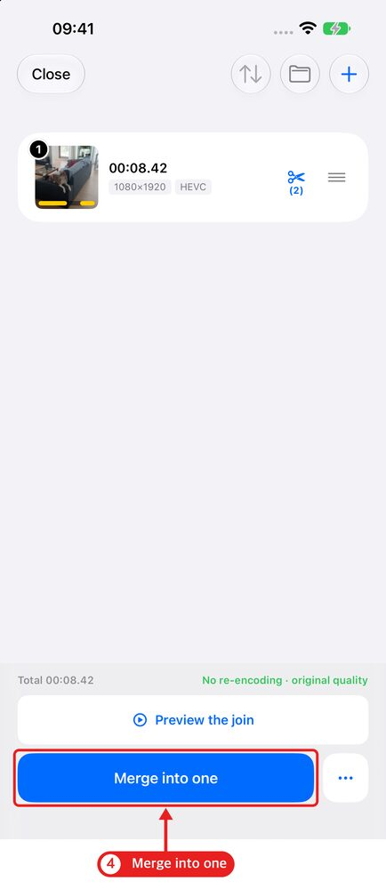
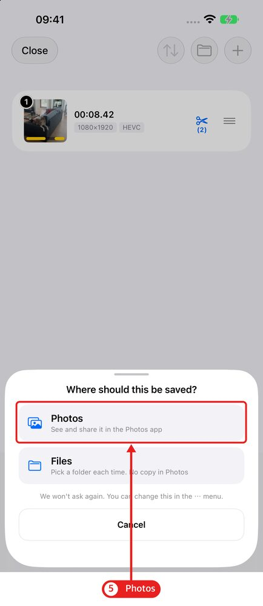

To trim a video on iPhone, open it in Photos, tap **Edit** and drag the ends of the frame strip. That cuts a slow start or a shaky end. Cutting out a few seconds in the middle needs one more step.

## How to trim a video on iPhone with the Photos app

1. Open the video in **Photos** and tap **Edit** (the sliders icon at the bottom).
2. Drag either end of the frame strip under the video. The strip turns yellow, and the part outside the handles is cut.
3. Tap **Done** (the yellow check mark at the top right), then **Save Video as New Clip** to keep the original as well, or **Save Video** to replace it.

<figure><figcaption>1. Tap Edit</figcaption></figure>
<figure><figcaption>2. Drag the ends of the strip</figcaption></figure>

<figure><figcaption>3. Done, then Save Video as New Clip</figcaption></figure>

It is free, and it is the quickest way when the part you don't want is at the start or the end.

## Can you delete part of a video in the middle on iPhone?

Not in Photos. The trim handles only move in from the two ends, so anything in the middle stays. The usual workaround is to save the video twice, trimmed two different ways, and then join the two clips in another app.

| | Photos | JoinCut |
|---|---|---|
| Cut the start or the end | ✓ | ✓ |
| Cut a part out of the middle | ✗ | ✓ |
| Keep two parts and join them | ✗ | ✓ |
| Zoom in for a precise cut | ✗ | ✓ up to 8x |
| Quality | Same video | Same video, nothing re-encoded |
| Free | ✓ | ✓ up to 2 parts per video |

## How to cut out the middle of a video on iPhone

We make [JoinCut](/apps/joincut/) for this.

1. Tap **Choose from Photos** and pick the video. The video appears in a list; tap **Trim** (the scissors) next to it to open the trimmer.
2. Drag the yellow handles around the first part you want to keep, the bit before the scene you want gone.
3. Tap **Add segment** and drag the new yellow handles around the second part, the bit after it. Then tap the check mark at the top right.
4. Tap **Merge into one**. The two parts are joined into one video.
5. The first time, JoinCut asks where to save. Tap **Photos**.

<figure><figcaption>1. Choose from Photos</figcaption></figure>
<figure><figcaption>2. Drag the yellow handles around part 1</figcaption></figure>

<figure><figcaption>3. Add segment, set part 2, tap the check mark</figcaption></figure>
<figure><figcaption>4. Merge into one</figcaption></figure>

<figure><figcaption>5. Save to Photos</figcaption></figure>

The middle is gone, and the cut is clean: JoinCut copies the frames you kept instead of drawing them again, so the video looks exactly like the original and saves in seconds. Zoom the strip to 2x, 4x or 8x when the cut has to land on a precise moment.

## Is it free?

Yes for this. Keeping two parts of a video and saving them is free, with no ads and no watermark. JoinCut Plus adds three or more parts per video, joins three or more videos at once, and saves parts as separate files. It is a weekly or yearly plan, or a one-time lifetime purchase.

If the video is an MKV file, Photos won't open it: see [how to play MKV files on iPhone](/blog/open-mkv-files-on-iphone/). To keep only the sound, see [how to extract audio from a video](/blog/extract-audio-from-video-iphone/). To join whole clips instead of cutting one, see [how to combine videos on iPhone without losing quality](/blog/merge-videos-iphone-without-losing-quality/). To turn the trimmed clip into a GIF, see [how to turn a video into a GIF on iPhone](/blog/video-to-gif-iphone/).

JoinCut also runs on Android. If the clip you want to trim is a screen recording that came out silent, see [how to screen record with sound on Android](/blog/screen-record-with-sound-android/).
