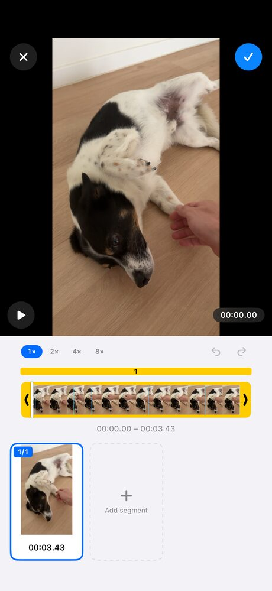
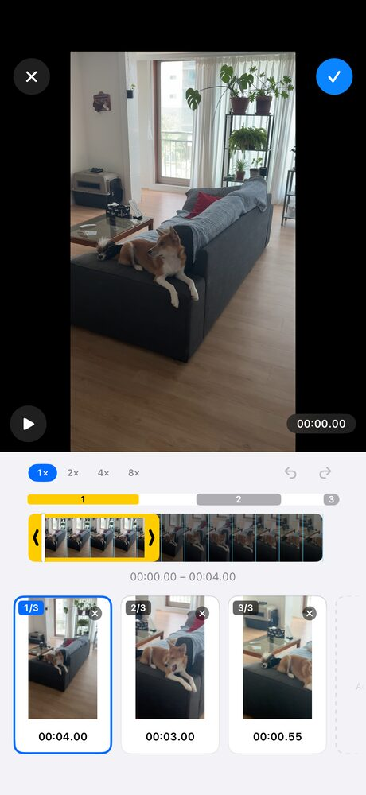

To trim a video on iPhone, open it in Photos, tap **Edit** and drag the ends of the frame strip. That cuts a slow start or a shaky end. Cutting out a few seconds in the middle needs one more step.

## How to trim a video on iPhone with the Photos app

1. Open the video in **Photos** and tap **Edit**.
2. Drag either end of the frame strip under the video. The part outside the handles is cut.
3. Tap **Done**, then **Save Video as New Clip** to keep the original as well, or **Save Video** to replace it.

It is free, and it is the quickest way when the part you don't want is at the start or the end.

## Can you delete part of a video in the middle on iPhone?

Not in Photos. The trim handles only move in from the two ends, so anything in the middle stays. The usual workaround is to save the video twice, trimmed two different ways, and then join the two clips in another app.

| | Photos | JoinCut |
|---|---|---|
| Cut the start or the end | ✓ | ✓ |
| Cut a part out of the middle | ✗ | ✓ |
| Keep two parts and join them | ✗ | ✓ |
| Zoom in for a precise cut | ✗ | ✓ up to 8x |
| Quality | Same video | Same video, nothing re-encoded |
| Free | ✓ | ✓ up to 2 parts per video |

## How to cut out the middle of a video on iPhone

We make [JoinCut](/apps/joincut/) for this.

<figure><figcaption>Drag the yellow handles to choose a part</figcaption></figure>
<figure><figcaption>Several parts of one video, joined in order</figcaption></figure>

1. Tap **Choose from Photos** and pick the video. The trimmer opens.
2. Drag the yellow handles around the first part you want to keep, the bit before the scene you want gone.
3. Tap **Add segment** and set the second part, the bit after it.
4. Tap the check mark, then **Merge into one**. The two parts are joined into one video and saved to Photos.

The middle is gone, and the cut is clean: JoinCut copies the frames you kept instead of drawing them again, so the video looks exactly like the original and saves in seconds. Zoom the strip to 2x, 4x or 8x when the cut has to land on a precise moment.

## Is it free?

Yes for this. Keeping two parts of a video and saving them is free, with no ads and no watermark. JoinCut Plus adds three or more parts per video, joins three or more videos at once, and saves parts as separate files. It is a weekly or yearly plan, or a one-time lifetime purchase.

To join whole clips instead of cutting one, see [how to combine videos on iPhone without losing quality](/blog/merge-videos-iphone-without-losing-quality/).
