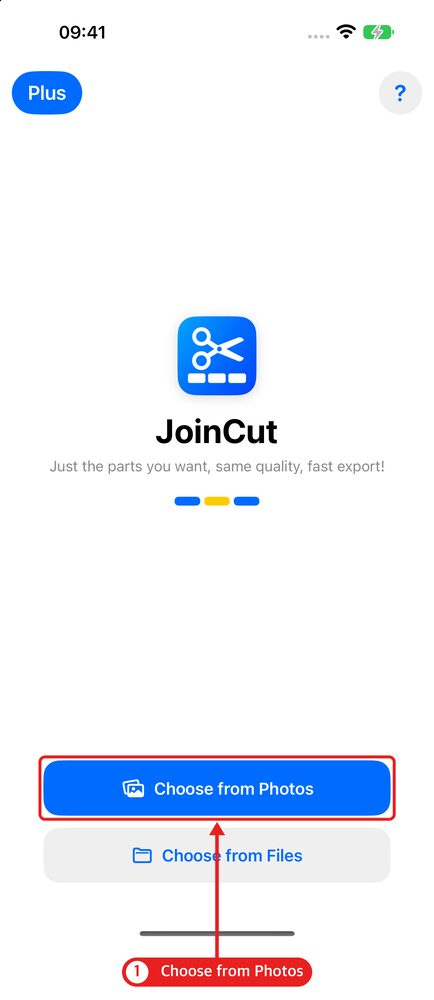
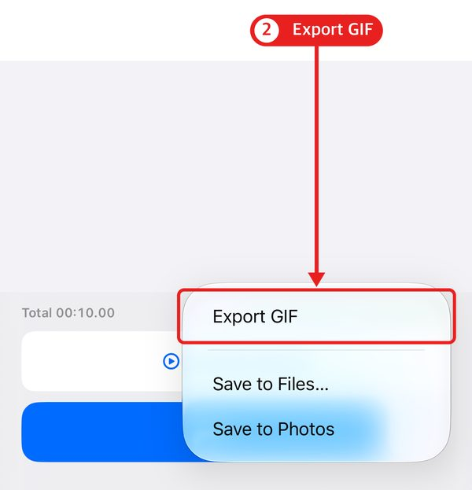
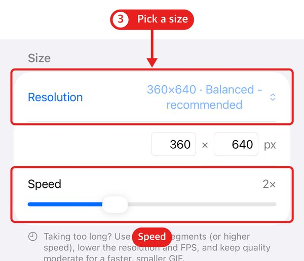
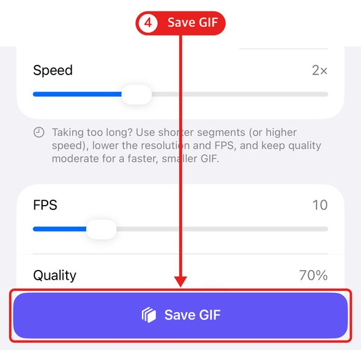
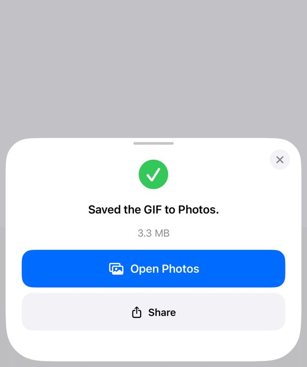

To turn a video into a GIF on iPhone, open it in a GIF app, pick a size and speed, and save the GIF to Photos. The Photos app can't save a video as a GIF by itself, so you need one extra app, or a shortcut you build yourself.

## Can the Photos app make a GIF?

No. Photos can trim a video and play a Live Photo as a loop, but it has no "save as GIF" button. The built-in way is the Shortcuts app: you can build a shortcut around its **Make GIF** action, but you set it up yourself and it gives you few choices about size and speed.

An app is quicker when you want to pick the part of the video, the size of the GIF and how fast it plays.

## How to make a GIF from a video on iPhone

We make [JoinCut](/apps/joincut/), a video joiner that also exports GIFs. Everything happens on the iPhone, nothing is uploaded.

1. Tap **Choose from Photos** and pick the video. To keep only part of it, tap **Trim** (the scissors) next to the video first. See [how to trim a video on iPhone](/blog/trim-video-iphone/).
2. Tap the **⋯** button next to **Save**, then **Export GIF**.
3. Pick a **Resolution** and a **Speed**. The preview at the top loops at the speed you chose.
4. Tap **Save GIF**. The GIF goes to Photos, ready to open or share.

<figure><figcaption>1. Choose from Photos</figcaption></figure>
<figure><figcaption>2. Tap ⋯, then Export GIF</figcaption></figure>

<figure><figcaption>3. Pick a Resolution and a Speed</figcaption></figure>
<figure><figcaption>4. Tap Save GIF</figcaption></figure>

<figure><figcaption>The GIF is in Photos</figcaption></figure>

Picked two videos? The GIF covers both, joined in the order of the list. That is a quick way to turn two short clips into one GIF.

## Which settings should I pick?

The defaults work for most videos: the "Balanced - recommended" size (640 px on the long side), 2x speed, 10 frames per second and 70% quality.

| Setting | Higher | Lower |
|---|---|---|
| Resolution | Sharper, bigger file | Smaller file, loads faster |
| Speed | Shorter GIF, faster motion | Longer GIF, real-time motion |
| FPS | Smoother motion, bigger file | Choppier, smaller file |
| Quality | Truer colors, bigger file | Smaller file |

GIFs get big fast because every frame is a full picture. If JoinCut says **The GIF is too long**, raise the speed, or lower the FPS or the resolution. Trimming the video to the moment you want helps the most.

## Is it free?

Yes. Making and saving GIFs is free, with no ads. Free GIFs carry a small "JoinCut" mark in the bottom-right corner. JoinCut Plus removes it, and also unlocks three or more parts per video and joining three or more videos at once. Plus is a weekly or yearly plan, or a one-time lifetime purchase.

To join whole clips into a video instead of a GIF, see [how to combine videos on iPhone without losing quality](/blog/merge-videos-iphone-without-losing-quality/). To keep only the sound of a video, see [how to extract audio from a video](/blog/extract-audio-from-video-iphone/).
